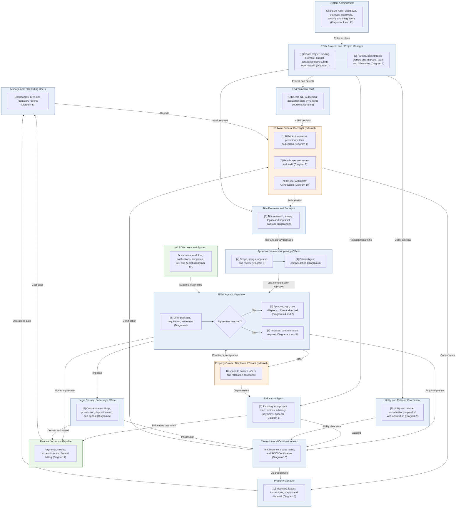

# Diagram 0 – Master Diagram – End-to-End ROW Process (ten-stage lifecycle)

Paste the block under **Diagram** into https://mermaid.live. It renders without errors (mermaid-cli 11.12). Size: about 4438 characters.

**Legend:** blue = ROW staff and approvers, orange = external party, green = system or finance. **Yellow = a new requirement (ROW-233 onward; see New_Requirements.md).** **Dashed purple outline = agency-specific item.** Evidence codes: **V** stated in a project source, **A** shown in your agency SOPs or workflows, **O** carried from your original diagram or feature list, **D** my design decision, **U** your decision.

Source short names: NDOT (Nevada DOT ROW Manual 2025), HDOT (Hawaii DOT HWY-R Manual 2025), ATP (Austin Transit Partnership manuals), TH (Training Handbook), TBW (Tampa Bay Water guideline), REM, GP, EF, PA SOP, ED SOP, Donation, Developer, Early, Settlement and RFF SOPs (Orange County, Florida), P1, P2 and Conveyance workflows, PUA matrix (City of Virginia Beach), IRWIN manuals, lifecycle document (Researcher Copilot).

## What changed in this final set

| Change | Reason |
|---|---|
| Rebuilt on the ten-stage lifecycle (stage numbers shown in brackets) | Your decision; lifecycle document |
| Added ROW Authorization (stage 1) and ROW Certification with federal concurrence (stage 9); new Clearance and Certification team | Lifecycle Stages 1 and 9; TH 4.4-4.5; HDOT; NDOT 2.411 |
| FHWA / federal oversight now appears at the start, middle and end | HDOT; TH |
| Relocation planning starts from the project, not from the Negotiator | ATP 6.3a; NDOT 8.403 |
| 'Parcel acquired' no longer comes from Finance; acquisition, relocation, utility and possession status all feed certification | PA SOP; lifecycle Stage 9 |
| Utility and railroad coordination runs in parallel from the project | NDOT ch.9, 11 |

## Diagram

## Source verification matrix

| Node | Evidence | Source and detail |
|---|---|---|
| FH_a [1] Authorization | V | TH 4.4 (project-level; supplemental when parcels are added); HDOT authorization letter; lifecycle Stage 1 deliverable. Diagram 1 |
| FH_b [7] Reimbursement and audit | O, V | ROW-079; HDOT objectives. Diagram 7 |
| FH_c [9] Certification concurrence | V | Lifecycle Stage 9; HDOT. Diagram 10 |
| A_a Configuration | O | Diagrams 1 and 11 |
| P_a, P_b [1], [2] Project and parcels | V | Lifecycle Stages 1 and 2; TH phases 1 and 2. Diagram 1 |
| E_a [1] NEPA and gate | V | NDOT 1.502-1.504; lifecycle Stage 1. Diagram 1 |
| T_a [3] Title and survey | V | Lifecycle Stage 3; TH phase 2; REM Phase I. Diagram 2 |
| AP_a, AP_b [4] Appraisal | V | Lifecycle Stage 4; NDOT 6. Diagram 3 |
| N_a to N_d [5], [6] Negotiation, closing, impasse | V, A | Lifecycle Stages 5 and 6; PA and ED SOPs. Diagrams 4, 6, 7 |
| O_a Owner | O | All sources |
| L_a [6] Condemnation | V | HDOT 2.9; ED SOP. Diagram 6 |
| R_a [7] Relocation | V | ATP; NDOT 8. Diagram 5 |
| U_a [8] Utilities and railroads | V | NDOT 9, 11; lifecycle Stage 8. Diagram 9 |
| F_a Payments and billing | V | RFF SOP; HDOT. Diagram 7 |
| CL_a [9] Clearance and certification | V | Lifecycle Stage 9; Practitioner Handbook Phase 6. Diagram 10 |
| PM_a [10] Property management | V | NDOT 13; lifecycle Stage 10. Diagram 8 |
| S_a, M_a Services, reports | O | Diagrams 12 and 13 |

## Open items

1. The two Aurigo lifecycles differ (nine phases in the Training Handbook, ten stages in the lifecycle document and a different phase list in the Practitioner Handbook). The Master follows the ten-stage document by your decision.
