# Diagram 1 – Project and Parcel Set-up, Owners and Acquisition Rules

Paste the block under **Diagram** into https://mermaid.live. It renders without errors (mermaid-cli 11.12). Size: about 8314 characters.

**Legend:** blue = ROW staff and approvers, orange = external party, green = system or finance. **Yellow = a new requirement (ROW-233 onward; see New_Requirements.md).** **Dashed purple outline = agency-specific item.** Evidence codes: **V** stated in a project source, **A** shown in your agency SOPs or workflows, **O** carried from your original diagram or feature list, **D** my design decision, **U** your decision.

Source short names: NDOT (Nevada DOT ROW Manual 2025), HDOT (Hawaii DOT HWY-R Manual 2025), ATP (Austin Transit Partnership manuals), TH (Training Handbook), TBW (Tampa Bay Water guideline), REM, GP, EF, PA SOP, ED SOP, Donation, Developer, Early, Settlement and RFF SOPs (Orange County, Florida), P1, P2 and Conveyance workflows, PUA matrix (City of Virginia Beach), IRWIN manuals, lifecycle document (Researcher Copilot).

## What changed in this final set

| Change | Reason |
|---|---|
| Parcel creator is a configurable lane: Designer, ROW staff or GIS, by agency | Your decision; REM and the product demo differ |
| Parcel status and agreement or interest status are configurable lists, each set manually | Your decision; product demo (status is a dropdown; a parcel can be in negotiation on one agreement and in condemnation on another) |
| Added the ROW acquisition plan and schedule | Lifecycle Stage 1 deliverable |
| New items now carry requirement IDs; ROW-022 lives in Diagram 5 | Your decisions |

## Diagram

```mermaid
flowchart TB
  subgraph SA["System Administrator – one-time configuration"]
    direction LR
    SA_a["Configure workflow template per work or acquisition type: fee, easement, temporary, donation, waiver, development conveyance, condemnation<br/>(ROW-071)"]
    SA_b["Define ordered steps and step-gating rules; gates depend on funding source<br/>(ROW-072)"]
    SA_c["Set statutory timelines, auto-assigned deadlines, delay alerts and URA-based reminders; set agency parcel clocks (for example 24 months per parcel, the last parcel sent starting the final countdown)<br/>(ROW-073, ROW-074)"]
    SA_d["Align process to Uniform Act; define parcel attribute library; share data across modules so it is entered once<br/>(ROW-075, ROW-011, ROW-084)"]
    SA_a --> SA_b
    SA_b --> SA_c
    SA_c --> SA_d
  end
  subgraph ES["Engineer and Surveyor (Public Works) – plan review"]
    direction LR
    ES_a["Review plans, ROW maps, legals and sketches at each design milestone (30%, 60%, 90%, 100%, pre-final, final) for the interests needed; add, revise or delete interests; send comments to consultant<br/>(ROW-239)"]
    ES_b{"Parcel approved for acquisition?"}
    ES_c["Prepare staff report and certificate of necessity<br/>(ROW-240)"]
    ES_d["Notify project manager; design continues"]
    ES_a --> ES_b
    ES_b -->|"Yes"| ES_c
    ES_b -->|"No"| ES_d
  end
  subgraph R["Requester (Public Works Project Coordinator, Project Engineer or other department)"]
    direction LR
    R_a["Submit typed Work Request (title work after design notice to proceed, or acquisition for each approved parcel): service needed, project, parcel list, attachments (ROW maps, plans, legals and sketches, Schedule Bs, transmittal letter, staff report, certificate of necessity), charge code or job authorization<br/>(ROW-080)"]
    R_b["Receive returned deliverables: title search reports and parcel maps (Diagram 2)<br/>(ROW-080)"]
  end
  subgraph AP["ROW Supervisor / Manager"]
    direction LR
    AP_a["Review Work Request; assign to ROW team or return for more information<br/>(ROW-080)"]
  end
  subgraph P["ROW Project Lead / Project Manager"]
    direction LR
    P_a["Create ROW project with unique ID (auto-generated or from another system); set region or district<br/>(ROW-001, ROW-003)"]
    P_b["Break project into WBS levels<br/>(ROW-002)"]
    P_c["Record funding source, oversight type (federal, state, local), design estimate and construction dates<br/>(ROW-004)"]
    P_d["Prepare quantity-based ROW cost estimate: area by interest type and land use, TCE years, condemnation premium; keep earlier versions<br/>(ROW-012)"]
    P_e["Establish project ROW budget from estimate and funding; record authorized amount and federal share where applicable<br/>(ROW-013)"]
    P_f["Prepare ROW acquisition plan and schedule: parcel list, timeline per parcel, budget<br/>(ROW-241)"]
    P_a --> P_b
    P_b --> P_c
    P_c --> P_d
    P_d --> P_e
    P_e --> P_f
  end
  subgraph G["Parcel Creator (Designer, ROW staff or GIS, by agency)"]
    direction LR
    G_a["Identify tracts from design plans on GIS quarter-section map<br/>(ROW-005)"]
    G_b["Assign parent-tract numbers; link each tract to its tax parcel numbers (APN or GPIN)<br/>(ROW-233)"]
    G_c["Create parcel record for each take under its parent tract: number, legal description, address, area, property type; interest and area: fee taking, remainder, permanent, utility, temporary easement<br/>(ROW-005, ROW-234)"]
    G_d{"Split or combine parcels needed?"}
    G_e["Combine or split parcels; create remnant parcels with new parcel ID<br/>(ROW-007)"]
    G_f["Group parcels under project or corridor with roll-up; assign attributes with status and comments<br/>(ROW-006, ROW-011)"]
    G_g["Batch-update multi-parcel projects<br/>(ROW-008)"]
    G_h["Prepare color map<br/>(ROW-235)"]
    G_i["Release tracts and parcel maps to title (Diagram 2)"]
    G_a --> G_b
    G_b --> G_c
    G_c --> G_d
    G_d -->|"Yes"| G_e
    G_d -->|"No"| G_f
    G_e --> G_f
    G_f --> G_g
    G_g --> G_h
    G_h --> G_i
  end
  subgraph A["ROW Agent / Negotiator (staff or consultant) – owners and parties"]
    direction LR
    A_a["Capture owners and every ownership interest on the parent tract (fee, easement, tenant, lender, trustee); update after title<br/>(ROW-014)"]
    A_b["Add contacts: attorneys, banks, owner designees<br/>(ROW-015)"]
    A_c["Record tenants and occupants<br/>(ROW-016)"]
    A_d["Capture W-9 / 1099 tax details for payees<br/>(ROW-018)"]
    A_f["Build abutters and interested-parties list<br/>(ROW-017)"]
    A_a --> A_b
    A_b --> A_c
    A_c --> A_d
    A_d --> A_f
  end
  subgraph P2["ROW Project Lead / Project Manager"]
    direction LR
    P2_a["Assign team roles per parcel: appraiser, negotiator, relocation agent, counsel<br/>(ROW-019)"]
    P2_b["Set parcel milestones and dates<br/>(ROW-010)"]
    P2_c["Review parcel synopsis and print<br/>(ROW-009)"]
    P2_a --> P2_b
    P2_b --> P2_c
  end
  subgraph X["ROW Agent / Negotiator (staff or consultant) – access and notice"]
    direction LR
    X_a["Request and track right of entry for pre-acquisition access (survey, testing)<br/>(ROW-077)"]
    X_b["Site visit: inspect parcel and confirm owner contact<br/>(ROW-236)"]
    X_n["Send written Notice to Owner of agency interest in acquiring the property and owner's basic protections; record date and method<br/>(ROW-237)"]
    X_c["Log every contact in the negotiation diary<br/>(ROW-020)"]
    X_d["Add permission-controlled parcel notes<br/>(ROW-021)"]
    X_a --> X_b
    X_b --> X_n
    X_n --> X_c
    X_c --> X_d
  end
  subgraph E["Environmental Staff / Oversight Approvals"]
    direction LR
    E_a["Record NEPA decision type (categorical exclusion, EA or EIS) and date<br/>(ROW-076)"]
    E_b["Record ROW authorizations: preliminary (appraisal and title, not negotiations) and acquisition, with authorized amount and federal share; confirm programming (STIP / TIP); add supplemental authorization when parcels are added<br/>(ROW-238)"]
    E_a --> E_b
  end
  subgraph GT["System (automated) – acquisition gate"]
    direction LR
    GT_a{"Federal or state oversight project?"}
    GT_b{"NEPA decision and acquisition authorization on file?"}
    GT_c{"Early acquisition (board-approved), hardship or protective acquisition approved?"}
    GT_d["Offers and negotiations unlocked<br/>(ROW-072)"]
    GT_e["Hold offers and negotiations; title, survey and preliminary appraisal continue<br/>(ROW-076)"]
    GT_a -->|"No: local funds (agency rules apply)"| GT_d
    GT_a -->|"Yes"| GT_b
    GT_b -->|"Yes"| GT_d
    GT_b -->|"No"| GT_c
    GT_c -->|"Yes"| GT_d
    GT_c -->|"No"| GT_e
  end
  subgraph N["ROW Agent / Negotiator (staff or consultant) – release"]
    direction LR
    N_b["Parcel ready for offer preparation (Diagrams 3 and 4)"]
  end
  subgraph S["System (automated)"]
    direction LR
    S_a["Provide configurable status lists at parcel level and at agreement or interest level; users set each manually<br/>(ROW-005)"]
    S_b["Track parcel milestones, flag delays and send alerts<br/>(ROW-010, ROW-073)"]
    S_a --> S_b
  end
  SA -->|"Rules in place"| ES
  SA -->|"Rules in place (title work)"| R
  ES -->|"Parcels approved for acquisition"| R
  R -->|"Work Request"| AP
  AP -->|"Assigned"| P
  AP -->|"Returned: more information needed"| R
  P -->|"Project and estimate"| G
  G -->|"Parcels created"| A
  A -->|"Owners captured"| P2
  P2 -->|"Team and milestones set"| X
  X -->|"Access arranged"| E
  E -->|"Status recorded"| GT
  GT -->|"Cleared for acquisition"| N
  N -->|"Parcel released"| S
  S -->|"Deliverables returned (Diagram 2)"| R
  classDef new fill:#fff8d6,stroke:#b8960c
  classDef agency stroke-dasharray:5 4,stroke:#7a4f9a
  class ES_a,ES_c,P_f,G_b,G_c,G_h,X_b,X_n,E_b new
  style SA fill:#e8f1fb,stroke:#4a78b5
  style ES fill:#e8f1fb,stroke:#4a78b5
  style R fill:#fdf0e0,stroke:#c07a1f
  style AP fill:#e8f1fb,stroke:#4a78b5
  style P fill:#e8f1fb,stroke:#4a78b5
  style G fill:#e8f1fb,stroke:#4a78b5
  style A fill:#e8f1fb,stroke:#4a78b5
  style P2 fill:#e8f1fb,stroke:#4a78b5
  style X fill:#e8f1fb,stroke:#4a78b5
  style E fill:#e8f1fb,stroke:#4a78b5
  style GT fill:#eaf6ea,stroke:#4a8f4a
  style N fill:#e8f1fb,stroke:#4a78b5
  style S fill:#eaf6ea,stroke:#4a8f4a
```

## Source verification matrix

| Node | Evidence | Source and detail |
|---|---|---|
| SA_a Workflow per type | O, A | ROW-071. Fee and suit (P2) and conveyance (DC) exist as separate activity networks. NDOT §6.203 recognizes donation and waiver valuation |
| SA_b Steps and gating | O | ROW-072. Gate evidence is in the gate rows below |
| SA_c Timelines, reminders, parcel clocks | O, A | ROW-073, ROW-074. Predecessor and Duration columns in P2 and DC are blank. Parcel clocks: ROW Acquisition overview and the Purchase Agreement and Donation SOPs give each parcel 24 months, and the last parcel sent to acquisition starts the final countdown; Eminent Domain SOP says 24+ months |
| SA_d Alignment, attributes, data sharing | O | ROW-075, ROW-011, ROW-084 |
| R_a Typed Work Request | V, A | REM Phase I (create parcel register, color map, order and QC title) and Phase II (parcel numbers, ROW maps, construction plans, legals and sketches, Schedule Bs); ROW Engineering SOP (title work requested after design notice to proceed); Purchase Agreement, Donation, Eminent Domain and Early SOPs (work request, transmittal letter, staff report and certificate of necessity per approved parcel); GP and EF show other request types; TH step 1; HDOT job authorization with charge code; NDOT §1.503 R/W Setting memo. **"TL" is read as transmittal letter (inferred; the SOPs never define it).** The field list is a composite |
| R_b Deliverables returned | A | REM Phase I last step (provide TSRs and parcel maps to the user agency); TH step 9 |
| AP_a Assign or return | A, O | REM "REM assigns the work to…"; HDOT: Principal ROW Agent assigns to the Supervising ROW Agent. "Return for more information" is from your ROW-080 flow only |
| P_a, P_b Project, region, WBS | O | ROW-001, 002, 003 |
| P_c Funding and oversight type | O, D | ROW-004. Oversight type is new. NDOT §1.502 processes federal-aid, state-funded and local public agency projects differently |
| P_d Quantity-based estimate | A, V | CAO fields (fee, permanent and temporary easement SF, TCE years, condemnation premium); NDOT §6.202 (R/W cost estimates for budget and planning). Version history is from ROW-012 |
| P_e Project ROW budget | D | ROW-013 (project budget; annual budgets moved to Diagram 13 per your decision). Concept supported by the HDOT authorization letter (ROW phase amount and 80% federal share) and TH (capital programs authorize spending). NDOT §2.312 shows an annual budget is a section-level operating budget. **No agency flow shows a budget step** |
| G_a Identify tracts | A, V | P1 Parcel Identification, GIS Quarter Section Map; TH step 2 |
| G_b Parent-tract numbers; APN/GPIN link | A, V, confirmed | P1 Parent Tract Numbering; P2 Parcel Association to Parent Tract; REM and GP scope appraisals per parent tract; TBW (uneconomic remainder, purchase of the entire parent tract); IRWIN §8.1 (APNs associated with a parcel number); CTV tax number/GPIN column |
| G_c Parcel record, interests and areas | O, A | Attributes from your original; CTV columns (total, fee taking, fee remainder, permanent, utility, temporary easement, proffers) | **ROW-234**
| G_d to G_g Split, group, batch | O | ROW-007, 006, 011, 008 |
| G_h Color map | A, V | P1 Color Map; REM Phase I; TH step 5 |
| G_i Release to title | A, V | P1 (Order Title follows Color Map); REM Phase I; TH step 6 |
| A_a Owners and interests on parent tract | O, D | ROW-014. Attaching to the parent tract is D, supported by REM (legals and Schedule Bs per parent tract). "Update after title": P2 shows three title updates |
| A_b, A_c, A_f Contacts, tenants, abutters | O | ROW-015, 016, 017 |
| A_d W-9 / 1099 | O, V | ROW-018. HDOT closing documents require a W-9 for IRS reporting, so data is needed by closing |
| P2_a to P2_c Roles, milestones, synopsis | O | ROW-019, 010, 009 |
| X_a Right of entry | V | TH (ROE = written permission for surveys, investigations, testing and other pre-acquisition activities); NDOT §7.430 (usually obtained before valuation and negotiations; construction-entry use restricted to exceptional cases). AUS treats possession and use agreements separately |
| X_n Notice to Owner | A, V, D | P2 activity E (after site visit, predecessor of the Offer Letter); REM (sent after the appraisal PO is approved); HDOT (notification on receipt of approved ROW maps and job authorization; written notice as soon as feasible of the agency's interest and the owner's basic protections; NDOT §7.403 identifies this as the 49 CFR 24.102(b) notice). HDOT and NDOT state a notice of intent to acquire establishes relocation eligibility (49 CFR 24.203(d)), so federal-aid timing relative to NEPA should be confirmed. Moved from after the gate (v2). **ROW-237** |
| X_c, X_d Diary, notes | O | ROW-020, 021. AUS requires communication to be placed in a contact log |
| E_a NEPA decision and date | V | NDOT §1.502 (environmental certification memo with NEPA approval and date); HDOT (offers follow NEPA requirements: EA, EIS or categorical exclusion) |
| E_b ROW authorizations | V | HDOT authorization text (preliminary ROW activities including appraisals, up to but not including negotiations; amount; federal share); NDOT §1.504 (authorization follows NEPA documents and programming, STIP/TIP; no federal-aid participation before authorization); TH (project-level; supplemental authorization when parcels are added) |
| GT_a Oversight project? | V, D | NDOT §1.502 (local public agency projects processed separately); HDOT FHWA guidance text (agency may buy before NEPA with its own funds, without reimbursement). The flag itself is D |
| GT_b NEPA and authorization on file? | V | NDOT §1.504; HDOT (acquisition begins after pre-acquisition work and NEPA) |
| GT_c Early, hardship, protective | V, A | NDOT §1.504 and §7.431; HDOT FHWA text cites 23 CFR 710.501 and 710.503 (limited number of parcels); Early Acquisition SOP (board approval of the request) |
| GT_d Unlocked | O | ROW-072 |
| GT_e Hold; preliminary work continues | O, V | ROW-076. NDOT §1.504 (preliminary appraisal may commence, with revision risk); HDOT FHWA text (appraisal and title work authorized before NEPA clearance) |
| ES_a, ES_b Plan review gate | A | ROW Engineering SOP (reviews at 30%, 60%, 90%, 100%, pre-final, final for the interests needed; interests added, revised or deleted; comments to consultant); ROW Acquisition overview (per parcel: approved → work request, rejected → project manager notified and design continues). **ROW-239** |
| ES_c Staff report, certificate of necessity | A | Purchase Agreement, Donation, Eminent Domain and Early SOPs ("Engineer prepares staff report and certificate of necessity"). **ROW-240** |
| ES_d Design continues | A | ROW Acquisition overview |
| N_b Release | D | Handoff to Diagrams 3 and 4 |
| Edge labels | D | "Assigned", "Cleared for acquisition" etc. are mine; "Deliverables returned" is from REM and TH |
| S_b Milestones and alerts | O | ROW-010, ROW-073 |
| X_b Site visit | A | P2 activity D. **ROW-236** |
| P_f Acquisition plan and schedule | V | Lifecycle Stage 1 deliverable (parcel list, timeline per parcel, budget); TH phase 1 outputs. **ROW-241** |
| G lane Parcel creator | V, U | REM (title examiner numbers parcels); TH (ROW Manager and GIS); Masterworks demo, July 2024 (design creates the parcel and fills the attributes). Configurable by your decision |
| S_a Status lists | V, U | ROW-005. Parcel status and agreement or interest status are separate configurable lists, each set manually, by your decision; the demo shows status is a dropdown because a parcel can be in negotiation on one agreement and in condemnation on another |

## Moved out of this diagram

| Feature | Now in |
|---|---|
| ROW-022 Title VI information | Diagram 5 |
| ROW-013 annual budgets | Diagram 13 |

## Open items

1. Notice to Owner timing for federal-aid projects (yours to verify): HDOT and NDOT say a notice of intent to acquire establishes relocation eligibility (49 CFR 24.203(d)).
2. CFR citation (yours to verify): the Training Handbook cites 23 CFR 710.201 for NEPA before acquisition; NDOT cites 710.203; HDOT lists 710.201 as State Responsibilities and 710.203 as Funding and Reimbursement.
