# Diagram 2 – Title, Abstraction and Survey

Paste the block under **Diagram** into https://mermaid.live. It renders without errors (mermaid-cli 11.12). Size: about 5862 characters.

**Legend:** blue = ROW staff and approvers, orange = external party, green = system or finance. **Yellow = a new requirement (ROW-233 onward; see New_Requirements.md).** **Dashed purple outline = agency-specific item.** Evidence codes: **V** stated in a project source, **A** shown in your agency SOPs or workflows, **O** carried from your original diagram or feature list, **D** my design decision, **U** your decision.

Source short names: NDOT (Nevada DOT ROW Manual 2025), HDOT (Hawaii DOT HWY-R Manual 2025), ATP (Austin Transit Partnership manuals), TH (Training Handbook), TBW (Tampa Bay Water guideline), REM, GP, EF, PA SOP, ED SOP, Donation, Developer, Early, Settlement and RFF SOPs (Orange County, Florida), P1, P2 and Conveyance workflows, PUA matrix (City of Virginia Beach), IRWIN manuals, lifecycle document (Researcher Copilot).

## What changed in this final set

| Change | Reason |
|---|---|
| New items carry requirement IDs; the portal reference points to Diagram 12 | Renumbering |
| Content otherwise as validated in the previous round |  |

## Diagram

```mermaid
flowchart TB
  subgraph TE1["ROW Title Examiner / Acquisition Agent – requests and orders"]
    direction LR
    TE1_a["Receive tracts and parcel maps released from Diagram 1; log title request with ROW maps, tax maps, legal descriptions and due date; estimate workload and delivery date<br/>(ROW-030)"]
    TE1_b["Request delivery order or purchase order; award and track title company or abstractor contract<br/>(ROW-031)"]
    TE1_c["Order title search; record order date<br/>(ROW-242)"]
    TE1_d["Submit survey request with submittal and completion dates; when contracted, obtain estimate, purchase order and notice to proceed<br/>(ROW-035)"]
    TE1_a --> TE1_b
    TE1_b --> TE1_c
    TE1_c --> TE1_d
  end
  subgraph TC["Title Company / Abstractor (external, or in-house abstracting section)"]
    direction LR
    TC_a["Receive order and upload deliverables through external portal (Diagram 12)<br/>(ROW-031)"]
    TC_b["Research chain of title and historical ownership<br/>(ROW-023)"]
    TC_c["Identify defects, liens, mortgages and encumbrances<br/>(ROW-024)"]
    TC_d["Upload and link deeds, plats, surveys and title search report to the parcel<br/>(ROW-026)"]
    TC_a --> TC_b
    TC_b --> TC_c
    TC_c --> TC_d
  end
  subgraph TE2["ROW Title Examiner – QC and defect review"]
    direction LR
    TE2_a["Record received date; QC title search report<br/>(ROW-242)"]
    TE2_b["Approve title company invoice; send for payment (Diagram 7)<br/>(ROW-243)"]
    TE2_c{"Defect or encumbrance found?"}
    TE2_d["Raise alert; track defect to resolution<br/>(ROW-024)"]
    TE2_e["Classify land type: private, condominium, conservation, recreation<br/>(ROW-029)"]
    TE2_f["Restrict confidential title opinions to legal role<br/>(ROW-028)"]
    TE2_g["Return title search report and parcel maps to requester (Diagram 1)"]
    TE2_a --> TE2_b
    TE2_a --> TE2_c
    TE2_c -->|"Yes"| TE2_d
    TE2_c -->|"No"| TE2_e
    TE2_d --> TE2_e
    TE2_e --> TE2_f
    TE2_f --> TE2_g
  end
  subgraph L["Legal Counsel / Attorney's Office"]
    direction LR
    L_a["Review confidential title opinions<br/>(ROW-028)"]
    L_b["Advise on defects that block a normal conveyance: owner clears title with agency help; if not curable, refer to condemnation (Diagram 6)"]
    L_a --> L_b
  end
  subgraph S["Surveyor / Chief Surveyor (in-house section or consultant)"]
    direction LR
    S_a["Receive survey request<br/>(ROW-035)"]
    S_b["Verify existing right-of-way limits and interest type: fee or easement<br/>(ROW-244)"]
    S_c["Collect field data: notes, GPS, total station<br/>(ROW-034)"]
    S_d["Prepare ROW plans, sketches and legal descriptions; upload CAD files (DWG, DGN) with layers<br/>(ROW-034)"]
    S_e["Exchange data with MicroStation, Trimble Business Center, Carlson<br/>(ROW-037)"]
    S_f["Record survey metadata and monumentation: as-built plans, field books<br/>(ROW-036)"]
    S_g["Chief Surveyor (licensed, in responsible charge) alone approves plans and any edits to them<br/>(ROW-039)"]
    S_a --> S_b
    S_b --> S_c
    S_c --> S_d
    S_d --> S_e
    S_e --> S_f
    S_f --> S_g
  end
  subgraph GIS["GIS Staff"]
    direction LR
    GIS_a["GIS document QC of legals, sketches and boundary survey; return comments<br/>(ROW-245)"]
  end
  subgraph EN["PW Engineering / Consultant Surveyor"]
    direction LR
    EN_a["Revise legals, sketches or boundary survey per comments; resubmit<br/>(ROW-246)"]
  end
  subgraph TE3["ROW Title Examiner – legal review and appraisal package"]
    direction LR
    TE3_a["Review legals and sketches (and boundary survey); request GIS document QC<br/>(ROW-246)"]
    TE3_b["Initial accepted legals and sketches<br/>(ROW-246)"]
    TE3_c["Begin title review and markup of settlement requirements; produce title review report and front sheet from template; finalize during negotiation<br/>(ROW-032)"]
    TE3_d["Assemble appraisal package: initialed legals and Schedule Bs per parent tract, updated title search report, vesting instruments, parent-tract and location aerial maps, county property appraiser printout, tax snapshot<br/>(ROW-247)"]
    TE3_e["Release appraisal package to Diagram 3"]
    TE3_a --> TE3_b
    TE3_b --> TE3_c
    TE3_c --> TE3_d
    TE3_d --> TE3_e
  end
  subgraph TU["ROW Title Examiner – updates through acquisition"]
    direction LR
    TU_a["Flag title for update when the project moves from preliminary to final and at acquisition events: after settlement, after approval package, after closing, after order of taking; run through current county date; refresh if over six months old at closing; keep versions<br/>(ROW-027)"]
    TU_b["When closing with a title company, request title commitment; review and mark up; record commitment number and expiration date<br/>(ROW-025)"]
    TU_c["Hand updated title to negotiation, closing and recording (Diagrams 4 and 7)"]
    TU_a --> TU_b
    TU_b --> TU_c
  end
  TE1 -->|"Title order"| TC
  TE1 -->|"Survey request"| S
  TC -->|"Title search report delivered"| TE2
  TE2 -->|"Defect referral, confidential opinion"| L
  L -->|"Cure advice"| TE2
  S -->|"Plans, sketches and legals approved"| TE3
  TE2 -->|"Title search report accepted"| TE3
  TE3 -->|"Request legal description QC"| GIS
  GIS -->|"Comments"| EN
  EN -->|"Revised legals"| TE3
  TE3 -->|"Updates triggered later (Diagrams 4, 6, 7)"| TU
  classDef new fill:#fff8d6,stroke:#b8960c
  classDef agency stroke-dasharray:5 4,stroke:#7a4f9a
  class TE1_c,TE2_a,TE2_b,S_b,GIS_a,EN_a,TE3_a,TE3_b,TE3_d new
  style TE1 fill:#e8f1fb,stroke:#4a78b5
  style TC fill:#fdf0e0,stroke:#c07a1f
  style TE2 fill:#e8f1fb,stroke:#4a78b5
  style L fill:#e8f1fb,stroke:#4a78b5
  style S fill:#e8f1fb,stroke:#4a78b5
  style GIS fill:#eaf6ea,stroke:#4a8f4a
  style EN fill:#fdf0e0,stroke:#c07a1f
  style TE3 fill:#e8f1fb,stroke:#4a78b5
  style TU fill:#e8f1fb,stroke:#4a78b5
```

## Source verification matrix

| Node | Evidence | Source and detail |
|---|---|---|
| TE1_a Log title request | O, A, V, D | ROW-030. P1 and REM Phase I work requests; HDOT Request to Abstract form carries ROW maps, tax maps, legal descriptions and suspense dates; TH "order title searches immediately after parcel identification". Release from Diagram 1 is D |
| TE1_b DO/PO and contract | O, A | ROW-031. REM Phase I "request delivery order or purchase order"; NDOT §5.201 (preliminary title reports may be bought from private title companies) |
| TE1_c Order title; order date | A, V | P1 Order Title; IRWIN §8.2 (title order history); TH (order date stamp). **ROW-242** |
| TE1_d Survey request | O, A | ROW-035. REM (title examiner requests boundary survey if applicable); GP (acquisition agent requests estimate, PO, notice to proceed, review, invoice) |
| TC_a Portal receipt | O | ROW-031. Diagram 12 ROW-173 already provides an external portal for title companies |
| TC_b, TC_c, TC_d Research, defects, links | O, V | ROW-023, 024, 026. HDOT Certificate of Search (owner, encumbrances, claimants); TH (TSR, O&E report, defects) |
| TE2_a Received date, QC | A, V | P1 Received Title → QC Title; REM "QC title search reports when received"; TH (received and QC dates); IRWIN file tracking. **ROW-242** |
| TE2_b Approve invoice | A | REM Phase I: examiner approves invoice; memo to REM fiscal analyst; to PW fiscal. Payment is Diagram 7. **ROW-243** |
| TE2_c, TE2_d Defect check and alert | O, V | ROW-024. HDOT; TH Challenge 1 (defect flags, overdue-report alerts) |
| TE2_e Land type | O | ROW-029. **No source evidence** (zero hits). Kept here, not moved, because I cannot place it more reliably |
| TE2_f Restrict opinions | O | ROW-028. No source describes role-restricted opinions. HDOT refers title-defect parcels to Legal Counsel; REM routes agreement changes through the County Attorney |
| TE2_g Return TSR and maps | A, V | P1 last step; REM Phase I; TH step 9 |
| L_a Review opinions | O | ROW-028 |
| L_b Cure advice | V | HDOT (parcels with title defects go to Legal Counsel; owner informed of just compensation and action taken); NDOT §7.511 (owner generally clears title; agency facilitates; condemnation if not curable; no monetary exceptions in the policy at close of escrow on a fee acquisition) |
| S_a Receive request | O | ROW-035 |
| S_b Existing ROW verification | V | NDOT §5.204. **Nevada-specific**; optional for other agencies. **ROW-244** |
| S_c Field data | O | ROW-034. No source evidence for the data types |
| S_d ROW plans, sketches, legals, CAD | V, A | NDOT §5.101, §2.404; TH (surveyors, metes-and-bounds, ROW plan maps); CTV is plotted from a .dgn file; EF requires a sketch of description signed and sealed by a professional surveyor |
| S_e Software exchange | O | ROW-037. CTV .dgn is consistent with MicroStation; no source for Trimble or Carlson |
| S_f Metadata, monumentation | O | ROW-036. **No source evidence** (zero hits) |
| S_g Chief Surveyor approval | V | NDOT §5.102 (Manager II, PLS in responsible charge gives final approval of R/W plans) and §5.302 (any revision needs approval). ROW-039 |
| GIS_a GIS document QC | A | REM, GP, EF ("send SOD to GIS to be QC"), P2 activity C, DC activity D. **ROW-245** |
| EN_a Revise legals | A | REM (PW Engineering requests consultant changes, approves, sends updated legals); GP (County Surveyor requests consultant). **ROW-246** |
| TE3_a, TE3_b Review, initial | A | REM Phase II: legal and sketch review, GIS Doc QC request, examiner reviews changes and initials the legals. **ROW-246** |
| TE3_c Title review report | A, O | REM ("begin title review/title markup (settlement requirements)"; "title examiner finalizes title review report"); P2 activity J Title Examination Report (after appraisal scoping, before Offer Letter). ROW-032 |
| TE3_d Appraisal package | A, D | REM Phase II lists initialed legals and Schedule Bs per parent tract, updated TSR, vesting instruments, parent-tract and location aerial maps, property appraisal printout, taxes snapshot; GP (title examiner numbers parcels, builds register, prepares location maps, prepares record title deed). **"County property appraiser printout" is my interpretation (see correction 3)** |
| TE3_e Release | D | Handoff to Diagram 3 |
| TU_a Title updates | A, V, O | P2 activities N, P, R, X; REM (update before board package and before closing; "through current County effective date"); HDOT six-month rule at closing. "Preliminary to final" trigger and versions are from ROW-027 |
| TU_b Title commitment | A, O | REM and GP (commitment requested if closing with a title company; reviewed and marked up). ROW-025 |
| TU_c Handoff | D | Diagrams 4 and 7 |
| Edge labels | D | Mine, except "Revised legals" and "Comments" from REM |

## Moved out of this diagram

| Feature | Now in |
|---|---|
| ROW-033 hearing notification | Diagram 12 |
| ROW-038 field-book migration | Diagram 11 |
| ROW-040 public inquiry | Diagram 12 (contract tracking in Diagram 7) |
| ROW-041 survey reports; ROW-030 workload reports | Diagram 13 |

## Open items

1. The REM 'Property Appraisal Printout' is read as the county Property Appraiser record; please confirm.
2. Features kept without source evidence: ROW-028, 029, 034 data types, 036, 037 (Trimble and Carlson).
3. Existing ROW verification (NDOT 5.204) is Nevada-specific; kept as an optional step.
