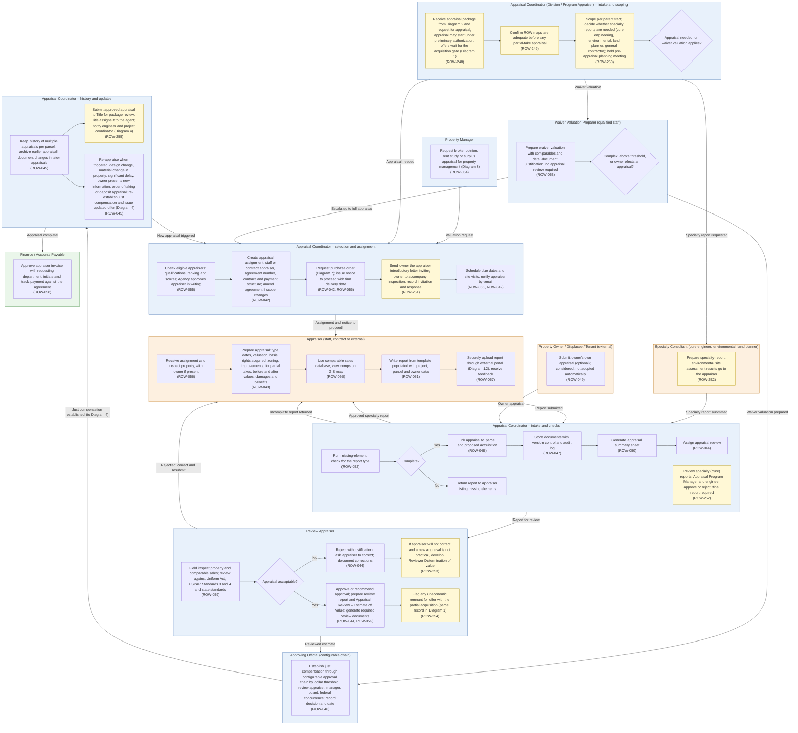

# Diagram 3 – Appraisal and Review

Paste the block under **Diagram** into https://mermaid.live. It renders without errors (mermaid-cli 11.12). Size: about 7254 characters.

**Legend:** blue = ROW staff and approvers, orange = external party, green = system or finance. **Yellow = a new requirement (ROW-233 onward; see New_Requirements.md).** **Dashed purple outline = agency-specific item.** Evidence codes: **V** stated in a project source, **A** shown in your agency SOPs or workflows, **O** carried from your original diagram or feature list, **D** my design decision, **U** your decision.

Source short names: NDOT (Nevada DOT ROW Manual 2025), HDOT (Hawaii DOT HWY-R Manual 2025), ATP (Austin Transit Partnership manuals), TH (Training Handbook), TBW (Tampa Bay Water guideline), REM, GP, EF, PA SOP, ED SOP, Donation, Developer, Early, Settlement and RFF SOPs (Orange County, Florida), P1, P2 and Conveyance workflows, PUA matrix (City of Virginia Beach), IRWIN manuals, lifecycle document (Researcher Copilot).

## What changed in this final set

| Change | Reason |
|---|---|
| New items carry requirement IDs; the portal reference points to Diagram 12 | Renumbering |
| Content otherwise as validated in the previous round |  |

## Diagram

## Source verification matrix

| Node | Evidence | Source and detail |
|---|---|---|
| PM_a Property management valuation | O, V | ROW-054. NDOT §6.302 (non-highway ROW properties) and §6.303 (excess property valuations): **section headings only**, text not read. Shared with Diagram 8 |
| AC1_a Intake from Diagram 2 | A, V, D | P2: Appraisal Package precedes Appraisal Scoping; REM Phase II. NDOT §1.504: preliminary appraisal may start before authorization; HDOT authorization text: preliminary activities "up to but not including negotiations". Linking to Diagram 2 is D. **ROW-248** |
| AC1_b ROW-map check | V | HDOT authorization text: appraisals of partial takings are not made until adequate ROW maps are prepared (cites 23 CFR 712.204(c)(2)). **ROW-249** |
| AC1_c Scoping, specialty needs, planning meeting | A, V | REM, GP and P2 (scoping per parent tract; extra consultants); NDOT §6.304 (pre-appraisal planning meeting); HDOT (pre-bid meeting). **ROW-250** |
| AC1_d Appraisal needed or waiver | V | NDOT §6.203 and HDOT: appraisal not required for a waiver valuation or for an owner donation with release. Donation path continues in Diagram 4 |
| W_a Waiver valuation | O, V | ROW-053. HDOT: a waiver valuation is not an appraisal, so no appraisal review; the agency official must still establish just compensation; data and comparables must support it; preparer must understand the local market and have no conflict; threshold $15,000 (NDOT §6.203 states the same) |
| W_b Escalation decision | V, D | HDOT: where federal approval exceeds the $15,000 threshold, the owner is offered the option of a State appraisal and if so the State obtains one. Escalation when the valuation is complex or above the threshold follows from the waiver conditions (D) |
| AC2_a Appraiser selection | V | ROW-055. NDOT §6.103: the Division Appraiser evaluates fee and review appraisers' qualifications annually; HDOT: selection committee ranks fee appraisers, Director approves; AUS: written agency approval; TH: pre-qualified panel |
| AC2_b Assignment, agreement, amendment | A, V | ROW-042. IRWIN: agreement number, amendments, staff vs consultant fields. REM: request for proposals then purchase order |
| AC2_c PO request and notice to proceed | A, V, D | REM and GP: purchase order via fiscal and procurement, then notice to proceed; AUS: approval of the appraiser is not a notice to proceed, which carries a firm delivery date. PO processing in Diagram 7 is D |
| AC2_d Owner invitation | V | NDOT §6.204 (introductory letter by certified mail; 49 CFR 24.102(c)(1)); TH (document invitation and response). **ROW-251** |
| AC2_e Schedule and notify | A, O | REM (coordinates inspection and deliverables); ROW-056, ROW-042 |
| SP_a Specialty report | V, A | NDOT §6.212 and §6.407; IRWIN Specialist Evaluation; REM and GP consultants; AUS (environmental site assessment results must reach the appraiser, per FTA Circular 5010.1F). **ROW-252** |
| A1_a Inspect | O | ROW-056 |
| A1_b Prepare appraisal | O, V | ROW-043. NDOT §6.206 and §6.501(D): before and after, damages and special benefits; IRWIN partial and total acquisition details |
| A1_c Comparable sales database | O | ROW-060. **No source describes a comparables database or GIS view** |
| A1_d Report template | O, V | ROW-051. NDOT §6.211 and §6.214 (report requirements, acceptable formats); AUS (agency approves report format) |
| A1_e Secure upload | O | ROW-057. Overlaps the external portal for appraisers in Diagram 12 (ROW-173) |
| O_a Owner's own appraisal | O, V | ROW-049. TBW owner letter (owner may obtain an appraisal and have it considered); Practitioner Handbook (owner disputes by commissioning an appraisal); AUS (new information from owner can require a new appraisal) |
| AC3_a Missing-element check | V | ROW-052. NDOT §6.501 review checklist A to E |
| AC3_b, AC3_g Complete? and return | D | Original had only the "Yes" edge |
| AC3_c to AC3_f Link, store, summary, assign review | O | ROW-048, 047, 050, 044. IRWIN's report summary covers all assessor parcels in the parcel. ROW-047 overlaps Diagram 12's version control (ROW-160) |
| R_a Review | V | ROW-059. NDOT §6.401 and §6.501 (field inspect property and comparables; USPAP Standards 3 and 4; 49 CFR 24.103); HDOT |
| R_c Approve and review documents | V | NDOT §6.501 (review report and Appraisal Review – Estimate of Value attached to the appraisal); IRWIN; HDOT Report of Review Appraiser (includes Title VI uniform-standards confirmation) |
| R_d Reject and correct | V | ROW-044. NDOT §6.501; REM "request revision if needed" |
| R_e Reviewer Determination | V | NDOT §6.408, §6.501. **ROW-253** |
| R_f Uneconomic remnant flag | V | NDOT §6.405 (49 CFR 24.102(k)): offer to acquire the uneconomic remnant with the partial acquisition. The parcel record is Diagram 1 (ROW-007). **ROW-254** |
| AP_a Establish just compensation | V, D | NDOT §6.402 (staff review appraiser establishes; outside fee reviewer, Assistant Chief); HDOT (reviewer estimates, ROW Manager approves); AUS (SVP below $250,000, board above, FTA memo above $1 million). A configurable chain is D |
| AC4_a History | O | ROW-045 (merges two original boxes) |
| AC3_h Specialty report review | A | Purchase Agreement and Eminent Domain SOPs: cure reports and the final cure report are reviewed and approved or rejected by the Appraisal Program Manager and the engineer. **ROW-252** |
| AC4_c Approved appraisal to Title | A | Same SOPs: Appraisal Program Manager submits the approved appraisal to Title; Title reviews the package and sends it to the agent; engineer and project coordinator notified. **ROW-255** |
| AC4_b Re-appraisal triggers | V, A | HDOT §2.2-13 (49 CFR 24.102(g)): update on material change or significant delay, then re-establish just compensation and offer in writing; AUS (owner new information, property change, delay, design changes, condemnation); P2 "OT Appraisal" and "Date of Deposit Appraisal". NDOT §1.504: FHWA authorizes appraisal work once, so design-change revisions risk eligibility |
| F_a Invoice and payment | A, V | REM and GP (invoice approved by requesting department, then fiscal); IRWIN (payments per agreement number). ROW-058 |
| Edge labels | D | Mine, except "Rejected: correct and resubmit" and "Report submitted" from your original |

## Moved out of this diagram

| Feature | Now in |
|---|---|
| ROW-062 map drill-through | Diagram 12 |
| ROW-061 summaries; ROW-050 status reports | Diagram 13 |
| PO processing for appraisers | Diagram 7 |

## Open items

1. Waiver threshold is $15,000 in NDOT and HDOT; I would make it configurable per agency.
2. ROW-054 evidence is section headings only (NDOT 6.302, 6.303).
3. ROW-060 (comparable sales database) has no source.
