# Diagram 4 – Negotiation, Offers, Agreements and Easements

Paste the block under **Diagram** into https://mermaid.live. It renders without errors (mermaid-cli 11.12). Size: about 9018 characters.

**Legend:** blue = ROW staff and approvers, orange = external party, green = system or finance. **Yellow = a new requirement (ROW-233 onward; see New_Requirements.md).** **Dashed purple outline = agency-specific item.** Evidence codes: **V** stated in a project source, **A** shown in your agency SOPs or workflows, **O** carried from your original diagram or feature list, **D** my design decision, **U** your decision.

Source short names: NDOT (Nevada DOT ROW Manual 2025), HDOT (Hawaii DOT HWY-R Manual 2025), ATP (Austin Transit Partnership manuals), TH (Training Handbook), TBW (Tampa Bay Water guideline), REM, GP, EF, PA SOP, ED SOP, Donation, Developer, Early, Settlement and RFF SOPs (Orange County, Florida), P1, P2 and Conveyance workflows, PUA matrix (City of Virginia Beach), IRWIN manuals, lifecycle document (Researcher Copilot).

## What changed in this final set

| Change | Reason |
|---|---|
| New items carry requirement IDs | Renumbering |
| Closing sets agreement status Acquired and parcel status, each manually | Your decision |
| Content otherwise as validated in the previous round |  |

## Diagram

```mermaid
flowchart TB
  subgraph ML["ROW Management (Chief or Manager, Legal, Contract Administrator) – pre-offer"]
    direction LR
    ML_a["Hold first-offer discussion; check funding availability; set offer threshold limits<br/>(ROW-256)"]
  end
  subgraph PL["ROW Supervisor / Project Lead – assignment"]
    direction LR
    PL_a["Assign negotiator (staff or consultant) to each parcel; check separation of functions; notify project lead, engineer and negotiator in system and by email<br/>(ROW-064)"]
  end
  subgraph N1["ROW Agent / Negotiator (staff or consultant) – offer"]
    direction LR
    N1_a["Notified: parcel ready; reviewed appraisal and just compensation (Diagram 3), title review report (Diagram 2), Notice to Owner and acquisition gate (Diagram 1) all on file<br/>(ROW-064)"]
    N1_b["Prepare preliminary settlement analysis to set negotiation range<br/>(ROW-257)"]
    N1_c["Assemble offer package, configurable by state: offer letter, appraisal summary statement or waiver valuation, agreement, deeds or easements, Acquisition, Ownership and Occupancy Data form, escrow instructions, Title VI and acquisition brochures, option to retain improvements<br/>(ROW-066)"]
    N1_d["Generate offer letter from template<br/>(ROW-063)"]
    N1_e["Deliver offer; record date, method and initiation-of-negotiations date; allow at least 30 days to respond; notify occupants of relocation eligibility (Diagram 5)<br/>(ROW-066, ROW-081)"]
    N1_f["Log contact in negotiation diary<br/>(ROW-020)"]
    N1_a --> N1_b
    N1_b --> N1_c
    N1_c --> N1_d
    N1_d --> N1_e
    N1_e --> N1_f
  end
  subgraph AP1["Offer Approvers – configurable by dollar threshold (Legal, Chief Engineer, ROW Manager, board)"]
    direction LR
    AP1_a["Approve first offer and counter-offers above threshold limits; board above the top threshold<br/>(ROW-258)"]
  end
  subgraph O["Property Owner / Displacee / Tenant (external)"]
    direction LR
    O_a["Receive and review offer"]
    O_b{"Owner response?"}
    O_c["Accept offer<br/>(ROW-063)"]
    O_d["Counter-offer, new information or own appraisal (Diagram 3)<br/>(ROW-063)"]
    O_e["Elect to retain improvements<br/>(ROW-068)"]
    O_f["Reject offer or no response"]
    O_a --> O_b
    O_b -->|"Accepts"| O_c
    O_b -->|"Counters"| O_d
    O_b -->|"Keeps improvements"| O_e
    O_b -->|"Rejects"| O_f
  end
  subgraph N2["ROW Agent / Negotiator – counter-offers and settlement"]
    direction LR
    N2_a["Record every offer, counter-offer, revised offer and withdrawal<br/>(ROW-063)"]
    N2_b["Negotiate with other interest holders and tenants: releases and subordinations; notify owner and tenant<br/>(ROW-259)"]
    N2_c["Set retention value and value salvage when owner retains improvements; store salvage form<br/>(ROW-068)"]
    N2_d["Request written counter-offer; if extent or compensation changes, send revised offer with appraisal summary statement and explanation<br/>(ROW-063, ROW-260)"]
    N2_e{"Settlement above approved just compensation?"}
    N2_f["Prepare administrative settlement: justification (appraisals including owner's, court awards, counsel opinion, trial cost, ineligible items), amount and payment breakdown<br/>(ROW-065)"]
    N2_g["Update agreement milestones; alert if dollar limits or due dates exceeded<br/>(ROW-081)"]
    N2_a --> N2_b
    N2_b --> N2_c
    N2_c --> N2_d
    N2_d --> N2_e
    N2_e -->|"Yes"| N2_f
    N2_e -->|"No"| N2_g
    N2_f --> N2_g
  end
  subgraph AP2["Approving Official – administrative settlement"]
    direction LR
    AP2_a["Approve administrative settlement before agreement with owner; settlement analysis; federal or transit concurrence by threshold<br/>(ROW-065)"]
  end
  subgraph N3["ROW Agent / Negotiator – agreement"]
    direction LR
    N3_a["Prepare agreement, deed or easement from template; title examiner prepares instruments from the title review report<br/>(ROW-063)"]
  end
  subgraph AP3["Approvers – agreement (Legal, Chief Engineer, board or ordinance by threshold)"]
    direction LR
    AP3_a["Approve draft agreement and settlement analysis by dollar threshold; owner-requested changes go to attorney and risk management<br/>(ROW-261)"]
    AP3_b["Board or ordinance approval where required; record approval date<br/>(ROW-081)"]
    AP3_a --> AP3_b
  end
  subgraph N5["ROW Agent / Negotiator – execution, due diligence and closing items"]
    direction LR
    N5_a["Collect e-signatures with timestamp and signature linked to the document, including tablet signing in person<br/>(ROW-179)"]
    N5_b["Acquire subordinations and releases; Chief signs co-existence letter if a subordination cannot be obtained<br/>(ROW-262)"]
    N5_c["For fee simple, order Phase I environmental site assessment; Phase II if recommended<br/>(ROW-263)"]
    N5_d["Possession and use agreement or incentive payment where the agency uses them; construction entry before payment only in exceptional cases with owner approval<br/>(ROW-264)"]
    N5_e["Record easement terms: type, purpose, location, grantor and grantee, legal description; add recorded-document reference after recording<br/>(ROW-078)"]
    N5_f["Track temporary easement time limits, expiry and notices; renew if construction extends<br/>(ROW-078)"]
    N5_g["Record approved short-term rent-back or occupancy arrangement; rent not above fair rental value (lease and billing in Diagram 8)<br/>(ROW-083)"]
    N5_h["Collect keys and garage-door openers at closing<br/>(ROW-070)"]
    N5_a --> N5_b
    N5_b --> N5_c
    N5_c --> N5_d
    N5_d --> N5_e
    N5_e --> N5_f
    N5_f --> N5_g
    N5_g --> N5_h
  end
  subgraph N4["ROW Agent / Negotiator – impasse path"]
    direction LR
    N4_a["Document last offer, owner ask, number of attempts and reasons; confirm at least 30 days since offer<br/>(ROW-067)"]
    N4_b["Notify owner in writing that negotiations cease and the agency will deposit just compensation and proceed by condemnation; request possession agreement; no coercive timing<br/>(ROW-067)"]
    N4_c["Prepare condemnation recommendation: ROW maps and descriptions, certificate of search, appraisal, offer letter, diary, correspondence (Diagram 6)<br/>(ROW-067)"]
    N4_a --> N4_b
    N4_b --> N4_c
  end
  subgraph BR["ROW Agent – donation, developer conveyance and early acquisition"]
    direction LR
    BR_a["Donation: inform donor of right to just compensation; obtain release from appraisal; obtain executed donation agreement; if not settled, ask project manager for a plan revision to eliminate the parcel<br/>(ROW-265)"]
    BR_b["Developer conveyance: development review condition requires donation by deed or plat; legals and sketches from ROW or developer; draft documents, title examination, GIS QC, send to user agency, executed documents returned, title update, QC, approval package, recording, GIS layer<br/>(ROW-266)"]
    BR_c["Early acquisition: request from manager or owner; engineer and surveyor review; board approval; staff report and certificate of necessity; continue to the offer process (gate in Diagram 1)<br/>(ROW-267)"]
    BR_a ~~~ BR_b
    BR_b ~~~ BR_c
  end
  subgraph PL2["ROW Program Manager / Staff Specialist – status and hand-off"]
    direction LR
    PL2_a["At closing set agreement status Acquired and parcel status, each manually (payments and closing in Diagram 7); hand off Acquisition, Ownership and Occupancy Data form to Property Management (Diagram 8)<br/>(ROW-082)"]
    PL2_b["After deed recording, review file, keep recorded deed copy and set agreement and parcel status Closed<br/>(ROW-268)"]
    PL2_a --> PL2_b
  end
  ML -->|"Offer authority and funding confirmed"| PL
  PL -->|"Parcel assigned"| N1
  N1 -->|"Offer for approval"| AP1
  AP1 -->|"Approved"| N1
  N1 -->|"Offer delivered"| O
  O -->|"Offer accepted"| N3
  O -->|"Counter-offer or response"| N2
  O -->|"Rejected or no response"| N2
  N2 -->|"Settlement above approved amount"| AP2
  N2 -->|"Agreement within authority"| N3
  N2 -->|"No agreement after reasonable efforts"| N4
  AP2 -->|"Approved: prepare agreement"| N3
  AP2 -->|"Rejected: owner may accept original offer"| N2
  AP2 -->|"Rejected: no agreement"| N4
  N3 -->|"Draft agreement for approval"| AP3
  AP3 -->|"Approved"| N5
  BR -->|"Executed donation or conveyance"| N5
  N5 -->|"Agreement signed; closing complete (payments: Diagram 7)"| PL2
  classDef new fill:#fff8d6,stroke:#b8960c
  classDef agency stroke-dasharray:5 4,stroke:#7a4f9a
  class ML_a,N1_b,AP1_a,N2_b,N2_d,AP3_a,N5_b,N5_c,N5_d,BR_a,BR_b,BR_c,PL2_b new
  style ML fill:#e8f1fb,stroke:#4a78b5
  style PL fill:#e8f1fb,stroke:#4a78b5
  style N1 fill:#e8f1fb,stroke:#4a78b5
  style AP1 fill:#e8f1fb,stroke:#4a78b5
  style O fill:#fdf0e0,stroke:#c07a1f
  style N2 fill:#e8f1fb,stroke:#4a78b5
  style AP2 fill:#e8f1fb,stroke:#4a78b5
  style N3 fill:#e8f1fb,stroke:#4a78b5
  style AP3 fill:#e8f1fb,stroke:#4a78b5
  style N5 fill:#e8f1fb,stroke:#4a78b5
  style N4 fill:#e8f1fb,stroke:#4a78b5
  style BR fill:#e8f1fb,stroke:#4a78b5
  style PL2 fill:#e8f1fb,stroke:#4a78b5
```

## Source verification matrix

| Node | Evidence | Source and detail |
|---|---|---|
| ML_a Pre-offer meeting, funding, thresholds | A | PA SOP and ED SOP: first-offer discussion with REM, Legal and the Chief Engineer; Chief Engineer and contract administrator check funding; Chief Engineer provides offer threshold limits. **ROW-256** |
| PL_a Assign negotiator | O, A, V | ROW-064. PA SOP: title assigns to the real estate agent, engineer and project coordinator notified. NDOT §7.405 (49 CFR 24.102(n)(3)): negotiator cannot be the appraiser, review appraiser or relocation agent; a waiver preparer may negotiate at $15,000 or less. The separation check is (extension of an existing feature) |
| N1_a Parcel ready | A, O | P2: Notice to Owner (E), appraisal received and reviewed (I) and Title Examination Report (J) all precede the Offer Letter (K). Original said only "after approved just compensation" |
| N1_b Preliminary settlement analysis | A | REM Phase II. **ROW-257** |
| N1_c Offer package | V, O | ROW-066. NDOT §7.502 (offer letter, appraisal summary statement or waiver valuation, agreement, deeds, Acquisition, Ownership and Occupancy Data form, escrow instructions); §7.406 and §7.407 (Title VI and acquisition brochures at initiation of negotiations); HDOT letter of offer and retention option. **Removed from the original list:** "Advice of Rights" (zero hits in all sources), "claim for payment" (relocation only), "possession agreement" (exceptional, now N5_d) and "relocation brochure" (relocation notices, N1_e). Package contents should be configurable by state |
| N1_d Offer letter | O | ROW-063 |
| N1_e Deliver offer | V, O | NDOT §7.403 (initiation of negotiations is the first contact with a written offer; 49 CFR 24.2(a)), §7.507 (at least 30 days; 24.102(f)), §7.416 (90-day notice on or after initiation), §8.409 (relocation eligibility notice generally the same date; eligibility begins at the earliest of notice of intent, initiation, binding agreement or acquisition; 24.203(b)). ROW-066, ROW-081 |
| N1_f Diary | O, V | ROW-020. NDOT §7.419 (24.9(a)) |
| AP1_a Offer approvers | A, D | PA SOP: under $100,000 REM proceeds; $100,000 to $500,000 Legal, Chief Engineer and REM Manager approve; above $500,000 the same approvers. ED SOP adds the board above $500,000 (**the SOPs differ**). A configurable chain is D. **ROW-258** |
| O_a to O_f Owner response | O, V | ROW-063, 068. NDOT §7.507 (30 days to consider and present material). Owner's own appraisal and new information: TBW owner letter, AUS, HDOT settlement inputs |
| N2_a Record offers | O, V | ROW-063. IRWIN offer, revised offer and owner's counter-offer; NDOT §7.506 |
| N2_b Interest holders, tenants | A, V | REM (release or subordinate interests); NDOT §7.410 (notify owner and tenant). **ROW-259** |
| N2_c Retention value, salvage | O, V | ROW-068. NDOT §7.418; HDOT (retention value pre-determined by Property Management or Appraisal) |
| N2_d Written counter-offer, revised offer | V | NDOT §7.513 (attempt to obtain a written counter-offer), §7.506 (revised offer with appraisal summary statement and explanation; 49 CFR 24.102(g)). **ROW-260** |
| N2_e Above approved amount? | D | Branch from HDOT (settlement after reasonable efforts at the approved amount fail) and the settlement analysis in the SOPs |
| N2_f Administrative settlement | O, V | ROW-065. HDOT justification inputs (all appraisals including the owner's, approved just compensation, court awards, negotiator's record, Legal Counsel opinion and trial cost, ineligible items); NDOT §7.513 (24.102(i)); GP (settlement analysis when price exceeds appraised value, up to a 10% cap) |
| N2_g Milestone alerts | O, A | ROW-081. PA SOP notifications |
| AP2_a Settlement approval | V, A | HDOT (Principal ROW Agent concurs, ROW Manager approves; approved amount set before agreement; if disapproved, condemnation unless the owner accepts the original; FHWA concurrence optional); NDOT §7.513 (delegated official, separate from appraisal review); AUS (FTA concurrence at 15%, $50,000 or $1 million); Settlement SOP (analysis to Legal and the Chief Engineer, rejected returns for editing). "Review Acquisition Review Report" from the original removed: zero hits |
| N3_a Prepare agreement | O, A | ROW-063. REM and GP (title examiner drafts the contract and instruments) |
| AP3_a Agreement approval | A | PA SOP (Chief Engineer and Legal approve the draft agreement, plus the settlement analysis from $100,000); REM and GP (owner-requested changes go to the County Attorney and Risk Management). **ROW-261** |
| AP3_b Board or ordinance | A, O | PA SOP (ordinance date; board above $500,000); REM (board package); P2 Approval Package. ROW-081 |
| N5_a E-signatures | V | ROW-179. NDOT §7.403 safeguards (date and timestamp record, signature linked to the document, certification; 49 CFR 24.5); York RFP (tablet signing) |
| N5_b Subordinations | A | PA SOP and Donation SOP (acquire all subordinations; Chief signs a co-existence letter if impossible). **ROW-262** |
| N5_c Environmental site assessment | A | REM, GP, PA SOP (Phase I for fee simple, Phase II if recommended, with PO and fund-code approvals); AUS. **ROW-263** (closes register item 26) |
| N5_d Possession and use, incentive | V | NDOT §7.505 (incentive payments: Chief R/W Agent approval, project-specific, uniform, offered with the offer, at least 30 days), §7.514 and HDOT (construction entry before payment only in exceptional circumstances with owner approval; 24.102(j)); AUS (possession and use agreements and incentive payments as the agency instructs). **ROW-264** (closes register item 12) |
| N5_e Easement terms | O, A | ROW-078. P2 and REM: recording follows closing, so the recorded reference is added later |
| N5_f TCE tracking | O, V | ROW-078. TH: TCEs must be renewed if construction extends |
| N5_g Rent-back | V | ROW-083. HDOT Fair Rental (24.102(m)) and Chapter 5.2; NDOT §13.602 (Property Management waits for notice that occupants moved or rent-back was approved); IRWIN Property Management lease and rental process |
| N5_h Keys | O | ROW-070. **No source evidence** (zero hits). Kept |
| N4_a Impasse record | V, A | ROW-067. ED SOP ("unable to settle after a minimum of 30 days"); HDOT impasse; NDOT §7.409 and §7.507 (no coercion; 24.102(h), (f)) |
| N4_b Impasse notice | V, O | HDOT (owner informed in writing the State will deposit just compensation and acquire by condemnation, and of steps he may take). "Request possession agreement" is from the original feature text only |
| N4_c Recommendation package | V, A | HDOT exhibits (ROW maps and descriptions, certificate of search, appraisal, offer letter, diary, correspondence); ED SOP (engineer approves the parcel, resolution package, manager and board). Detail in Diagram 6 |
| BR_a Donation | A, V | Donation SOP; HDOT (donor informed of the right to just compensation; agency obtains an appraisal unless the owner releases it); NDOT §6.203. **ROW-265** |
| BR_b Developer conveyance | A | Developer SOP (development review condition; donation by deed or plat); DC workbook; EF. **ROW-266** |
| BR_c Early acquisition | A | Early SOP. "RCA" is not defined in the file. **ROW-267** |
| PL2_a Acquired and hand-off | A, V, O | PA SOP (status updated to acquired after the closing date); NDOT §13.602 (Acquisition, Ownership and Occupancy Data form). ROW-082 |
| PL2_b Closed | A, V | PA SOP (Title records the deed; REM provides a copy); NDOT §7.435 (final file review); EF (manager or title examiner approves closure); Aurigo consultants handbook ("mark acquisition as Closed"). **ROW-268** |
| Edge labels | D | Mine |

## Moved out of this diagram

| Feature | Now in |
|---|---|
| ROW-069 negotiator progress report | Diagram 13 |

## Open items

1. Offer approvals are drawn as a configurable chain; the Purchase Agreement SOP and Eminent Domain SOP differ on board approval above $500,000.
2. No source: 'Advice of Rights', 'Acquisition Review Report' (removed from node text) and keys (ROW-070, kept).
3. A 'final written offer' step appears only in the Aurigo consultants handbook; not drawn.
