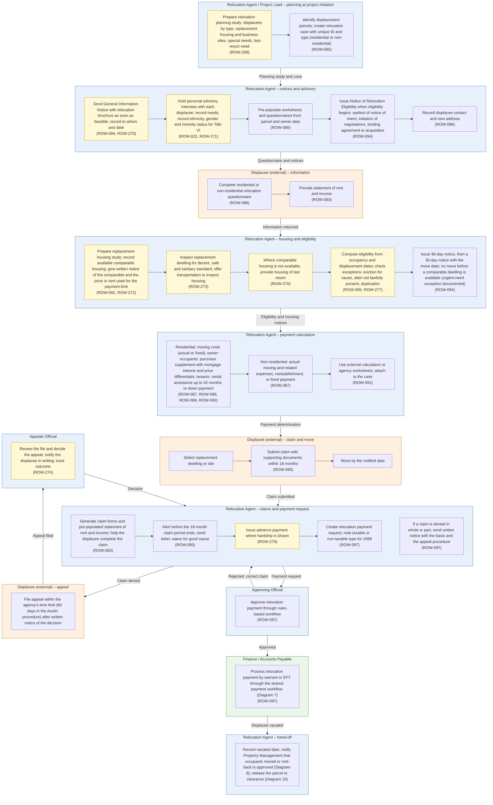

# Diagram 5 – Relocation Assistance

Paste the block under **Diagram** into https://mermaid.live. It renders without errors (mermaid-cli 11.12). Size: about 5922 characters.

**Legend:** blue = ROW staff and approvers, orange = external party, green = system or finance. **Yellow = a new requirement (ROW-233 onward; see New_Requirements.md).** **Dashed purple outline = agency-specific item.** Evidence codes: **V** stated in a project source, **A** shown in your agency SOPs or workflows, **O** carried from your original diagram or feature list, **D** my design decision, **U** your decision.

Source short names: NDOT (Nevada DOT ROW Manual 2025), HDOT (Hawaii DOT HWY-R Manual 2025), ATP (Austin Transit Partnership manuals), TH (Training Handbook), TBW (Tampa Bay Water guideline), REM, GP, EF, PA SOP, ED SOP, Donation, Developer, Early, Settlement and RFF SOPs (Orange County, Florida), P1, P2 and Conveyance workflows, PUA matrix (City of Virginia Beach), IRWIN manuals, lifecycle document (Researcher Copilot).

## What changed in this final set

| Change | Reason |
|---|---|
| Added relocation planning at project initiation, General Information Notice and personal advisory interview | ATP 6.1a, 6.3; NDOT 8.403, 8.408 (24.205(a), 24.203(a)) |
| Split payment determination by displacee type instead of a sequential chain | ATP 7, 8; NDOT 8.414-8.425 |
| Added comparable-dwelling notice, decent-safe-sanitary inspection, housing of last resort, eligibility exceptions, advance payments | ATP 6.2-6.8, 8.4 |
| 30-day notice moved from the displacee lane to the agency's notices | ATP 6.1c; NDOT 8.410 |
| Added appeal path | ATP 12; NDOT 8.411 (24.10) |
| ROW-022 (Title VI information) moved in from Diagram 1; ROW-098 (demolition) moved to Diagram 10; ROW-099 reports moved to Diagram 13 | Your decisions; IRWIN relocation screens; Practitioner Handbook Phase 6 |

## Diagram

## Source verification matrix

| Node | Evidence | Source and detail |
|---|---|---|
| RP_a Relocation planning | V | ATP 6.3a; NDOT 8.403 (49 CFR 24.205(a)): planning in early project development, before any displacing action; may include a relocation survey or study. **ROW-269** |
| RP_b Displacement parcels, case | O, V | ROW-085. TH Phase 2: identify displacement parcels and tag for relocation planning |
| R1_a General Information Notice | V | ATP 6.1a; NDOT 8.408 (usually the first personal contact); HDOT text of 49 CFR 24.203(a) ("as soon as feasible"). The FHWA relocation brochure (2005, dated) is the standard brochure; no dollar limits are quoted here. ROW-094, **ROW-270** |
| R1_b Advisory interview, Title VI | V, O, U | ATP 6.3b (personal interview with each residential and business displacee; needs and preferences). ROW-022 moved here by your decision; IRWIN keeps Ethnicity, Gender and Minority on displacee and owner records inside its relocation screens. **ROW-271** |
| R1_c Pre-populate worksheets | O | ROW-086 |
| R1_d Notice of Relocation Eligibility | V | ATP 6.1b; NDOT 8.409 (generally the same date as initiation of negotiations and the initial offer; eligibility begins at the earliest of notice of intent, initiation of negotiations, binding agreement or acquisition; 24.203(b)). ROW-094 |
| R1_e Contact and new address | O | ROW-096 |
| O1_a, O1_b Questionnaire, rent and income | O | ROW-086, ROW-093 |
| R2_a Replacement-housing study, written comparable notice | V, O | ATP 6.2 and 6.3b(2)(b) (at least one comparable, preferably three; written notice of the comparable and the price or rent used for the payment limit); NDOT 8.412. ROW-092, **ROW-272** |
| R2_b Decent, safe and sanitary inspection | V | ATP 6.3b(2)(c), (e): inspect comparable housing where feasible; offer transportation to inspect housing. **ROW-273** |
| R2_c Housing of last resort | V | ATP 8.4; NDOT 8.425. **ROW-276** |
| R2_d Eligibility and exceptions | V, O | ATP 6.1b, 6.4 (eviction for cause), 6.6 (aliens not lawfully present), 6.8 (no duplication). ROW-095, **ROW-277** |
| R2_e 90-day and 30-day notices | V | ATP 6.1c; NDOT 8.410: 90-day notice may be issued 90 days or earlier before displacement; a later notice gives the move date at least 30 days ahead; if issued before a comparable is available, no move earlier than 90 days after; urgent-need exception with a determination in the file. These are agency actions. ROW-094 |
| R3_a Residential payments | V, O | ATP 7.1, 7.2, 8.1, 8.2, 8.3; NDOT 8.414-8.424: payment types depend on displacee type and tenure (90-day occupancy rule, not 180); purchase supplement with mortgage interest and price differentials; rental assistance up to 42 months. ROW-087 to ROW-090. The original drew these as sequential steps; they are alternatives by tenure |
| R3_b Non-residential payments | V, O | ATP 7.1, 7.3-7.5; NDOT 8.417-8.421. ROW-087 |
| R3_c External calculators | O | ROW-091 |
| O2_a to O2_c Select, claim, move | O, V | ROW-093; ATP 6.5d (claims within 18 months of displacement or, for owners, the later of displacement or final acquisition payment) |
| R4_a Claim forms and help | V, O | ATP 6.5a (documentation and reasonable help completing the claim); NDOT 8.413 (24.207). ROW-093 |
| R4_b Claim-expiry alerts | V, O | ATP 6.5d (18 months; waived for good cause). ROW-095 |
| R4_c Advance payment | V | ATP 6.5c. **ROW-275** |
| R4_d Payment request | O | ROW-097 |
| R4_e Denial notice | V | ATP 6.5e: written notice of the basis and the appeal procedure |
| AP_a, F_a Approve and pay | O, D | ROW-097. Relocation payments use the shared payment workflow of Diagram 7 (design decision) |
| AL1_a, AL2_a Appeals | V | ATP 12.4 (60 days after written notification), 12.5-12.9; NDOT 8.411 (appeal form to the Director; relocation appeal concerns only relocation, dissatisfaction with acquisition goes to the negotiator; 24.10). **ROW-274** |
| H_a Hand-off | V | NDOT 13.602 (Property Management takes over after notice that occupants moved or rent-back is approved). Clearance in Diagram 10 |

## Moved out of this diagram

| Feature | Now in |
|---|---|
| ROW-098 demolition and securing | Diagram 10 |
| ROW-099 relocation reports | Diagram 13 |

## Open items

1. The appeal time limit and form are agency-specific (60 days in the Austin procedure). I draw them as the agency's limit.
2. Dollar limits for replacement housing payments are not shown because the only brochure in the files (2005) is dated.
