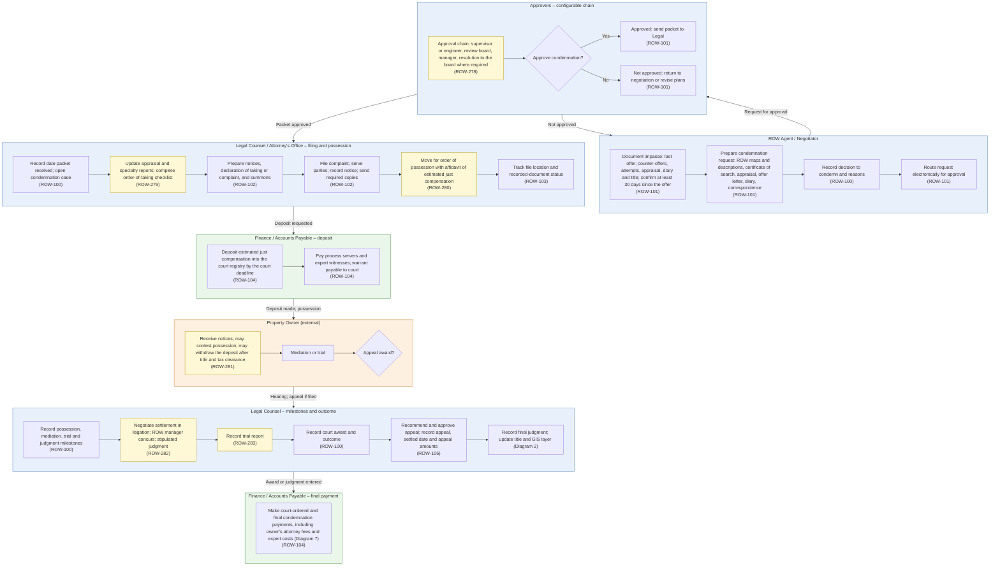

# Diagram 6 – Condemnation and Legal

Paste the block under **Diagram** into https://mermaid.live. It renders without errors (mermaid-cli 11.12). Size: about 3801 characters.

**Legend:** blue = ROW staff and approvers, orange = external party, green = system or finance. **Yellow = a new requirement (ROW-233 onward; see New_Requirements.md).** **Dashed purple outline = agency-specific item.** Evidence codes: **V** stated in a project source, **A** shown in your agency SOPs or workflows, **O** carried from your original diagram or feature list, **D** my design decision, **U** your decision.

Source short names: NDOT (Nevada DOT ROW Manual 2025), HDOT (Hawaii DOT HWY-R Manual 2025), ATP (Austin Transit Partnership manuals), TH (Training Handbook), TBW (Tampa Bay Water guideline), REM, GP, EF, PA SOP, ED SOP, Donation, Developer, Early, Settlement and RFF SOPs (Orange County, Florida), P1, P2 and Conveyance workflows, PUA matrix (City of Virginia Beach), IRWIN manuals, lifecycle document (Researcher Copilot).

## What changed in this final set

| Change | Reason |
|---|---|
| Approval is a configurable chain (supervisor or engineer, review board, manager, board resolution) | NDOT 2.410, 7.515; ED SOP; HDOT impasse section |
| Added order-of-taking checklist and pre-order updates | ED SOP |
| Added motion for order of possession and court deposit; deposit withdrawal by the owner | HDOT 2.9; ED SOP; RFF packet |
| Added settlement and stipulated judgment during litigation, trial report, final judgment recording | HDOT 2.9; ED SOP; Phase II suit path |
| Moved condemnation-rate analytics (ROW-105) to Diagram 13 | Reporting capability |

## Diagram

## Source verification matrix

| Node | Evidence | Source and detail |
|---|---|---|
| A_a, A_b Impasse record and request | V, O | ROW-101. ED SOP (unable to settle after a minimum of 30 days); HDOT request exhibits (ROW maps and descriptions, certificate of search, appraisal, offer letter, diary, correspondence) |
| A_c, A_d Decision, routing | O | ROW-100, ROW-101 |
| AP_c Approval chain | V, A | NDOT 2.410 (Negotiator's Report, Condemnation Review Board, resolution to the Transportation Board); ED SOP (engineer approves parcel, REM Manager approves, board approves resolution, then Litigation); HDOT (Principal ROW Agent concurs, ROW Branch Head approves). Configurable. **ROW-278** |
| AP_a, AP_b, AP_d Decision | O | ROW-101 |
| L1_a Open case | O | ROW-100 |
| L1_b Order-of-taking checklist | A | ED SOP: updated cure report, updated appraisal requested by Legal, checks of parcel file, schedules, legals and testimony, reserve deposit. **ROW-279** |
| L1_c, L1_d Documents, filing | O, V | ROW-102. HDOT: complaint with description (Exhibit A) and map (Exhibit B), summons answered within 20 days |
| L1_e Order of possession | V | HDOT: ex parte motion with affidavit of estimated just compensation; deposit required before the order; owner may contest within 10 days. **ROW-280** |
| L1_f File tracking | O | ROW-103 (the original wording named "Land Titles", generalised) |
| F1_a Court deposit | V, A | HDOT (request for payment, warrant, receipt of deposit, certificate of deposit and possession); ED SOP (deposit no later than 20 days after the order); RFF packet (deposit into the court registry by the deadline). ROW-104 |
| F1_b Servers and experts | O | ROW-104 |
| O_a Notices, contest, withdrawal | V | HDOT: owner may withdraw the deposit if title is clear or by motion; tax clearance; withdrawal abandons defences except further compensation. **ROW-281** |
| O_b, O_c Mediation or trial, appeal | O, A | ED SOP: mediation, then trial |
| L2_a Milestones | O | ROW-100 |
| L2_b Settlement in litigation | V, A | HDOT (attorney recommends, ROW Manager concurs, FHWA concurrence optional, stipulated judgment); ED SOP (mediation settlement approved by PW, REM and Litigation). **ROW-282** |
| L2_c Trial report | V | HDOT trial report contents. **ROW-283** |
| L2_d Award and outcome | O | ROW-100 |
| L2_e Appeal | V, O | HDOT (trial attorney recommends, Senior Deputy reviews, ROW Manager approves). ROW-106 |
| L2_f Final judgment, title, GIS | A | Phase II (final judgment recording, GIS layer); ED SOP |
| F2_a Final payments | V, O | RFF packet (final judgment, attorney fees, expert costs); ROW-104 |

## Moved out of this diagram

| Feature | Now in |
|---|---|
| ROW-105 condemnation-rate analytics | Diagram 13 |

## Open items

1. Interest on awards is not federally eligible in Hawaii; handled in Diagram 7 categorisation.
2. Land Court subdivision and inverse condemnation (Hawaii) are state-specific and not drawn.
