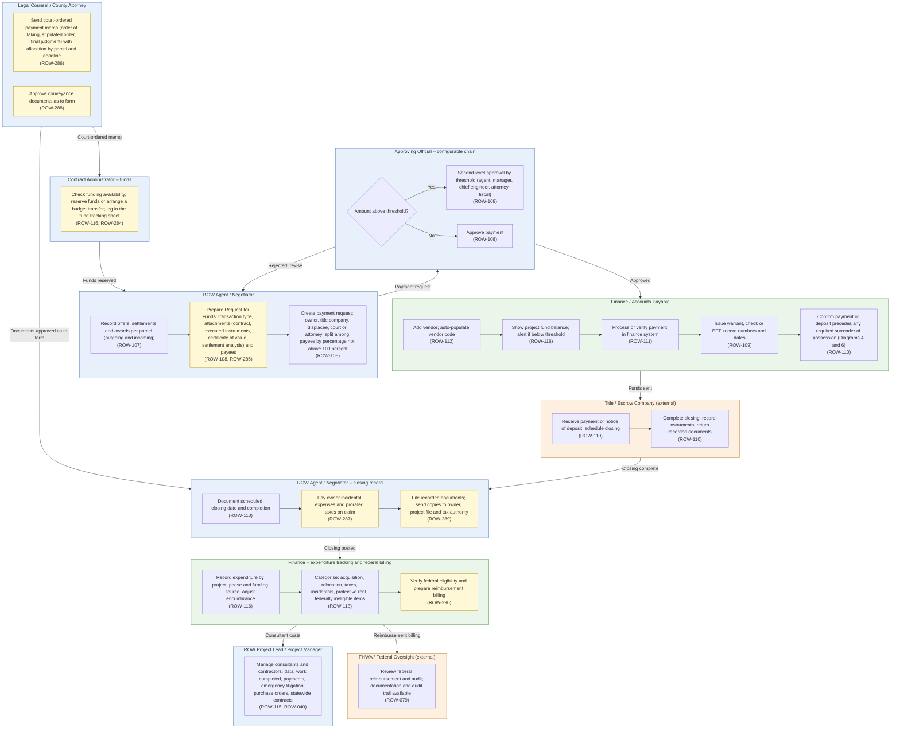

# Diagram 7 – Payments, Closing and Financial Control

Paste the block under **Diagram** into https://mermaid.live. It renders without errors (mermaid-cli 11.12). Size: about 4274 characters.

**Legend:** blue = ROW staff and approvers, orange = external party, green = system or finance. **Yellow = a new requirement (ROW-233 onward; see New_Requirements.md).** **Dashed purple outline = agency-specific item.** Evidence codes: **V** stated in a project source, **A** shown in your agency SOPs or workflows, **O** carried from your original diagram or feature list, **D** my design decision, **U** your decision.

Source short names: NDOT (Nevada DOT ROW Manual 2025), HDOT (Hawaii DOT HWY-R Manual 2025), ATP (Austin Transit Partnership manuals), TH (Training Handbook), TBW (Tampa Bay Water guideline), REM, GP, EF, PA SOP, ED SOP, Donation, Developer, Early, Settlement and RFF SOPs (Orange County, Florida), P1, P2 and Conveyance workflows, PUA matrix (City of Virginia Beach), IRWIN manuals, lifecycle document (Researcher Copilot).

## What changed in this final set

| Change | Reason |
|---|---|
| Fund reservation moved before approval; encumbrance adjusted at expenditure | RFF SOP; PA SOP |
| Added Request for Funds form content and court-ordered payments | RFF SOP packet |
| Added closing documents approved as to form, incidental expenses, recording and distribution | HDOT 2.8; REM; PA SOP |
| Added federal reimbursement verification and billing | HDOT objectives (limited evidence) |
| Moved reports (ROW-113 FHWA expenditure reports, ROW-114) to Diagram 13 | Reporting capability |

## Diagram

## Source verification matrix

| Node | Evidence | Source and detail |
|---|---|---|
| FA_a Fund reservation | V, A | RFF SOP (Contract Administrator reserves funds or arranges a budget transfer, logs the fund tracking sheet, then approvals); PA SOP (funding checked before the first offer). ROW-116, **ROW-284** |
| L_a Court-ordered payment memo | A | RFF packet: County Attorney memos for orders of taking with allocation by parcel (compensation, attorney fees, expert fees) and a deposit deadline. **ROW-286** |
| L_b Approve as to form | V | HDOT 2.8 (Legal Counsel approves conveyance documents as to form). **ROW-288** |
| A_a Record offers and awards | O | ROW-107 |
| A_b Request for Funds | A | RFF SOP form: BCC or ordinance approval, transaction type (pre- or post-condemnation, at, below or above approved appraisal, advance payment), attachments (contract, executed instruments, certificate of value, settlement analysis), payees including attorney trust accounts and recording fees. ROW-108, **ROW-285** |
| A_c Payment request, payees | O | ROW-108 |
| AP_a to AP_c Approvals | O, A | ROW-108. RFF SOP: agent recommends; REM manager, chief engineer, engineering manager and fiscal approve; county attorney above thresholds. Configurable |
| F1_a to F1_d Vendor, balance, process, issue | O | ROW-112, 116, 111, 109 |
| F1_e Payment before possession | V | NDOT 7.417, 7.514 (24.102(j)); HDOT 2.2-14. ROW-110 |
| TC_a, TC_b Closing | O, V | ROW-110. NDOT 7.424 (all acquisitions through escrow unless directed otherwise), 7.435 (final escrow billing, owner's policy of title, final settlement statement) |
| A2_a Closing record | O | ROW-110 |
| A2_b Incidental expenses | V | HDOT 2.8 (recording fees, mortgage prepayment penalty, prorated taxes on claim); NDOT 7.512. **ROW-287** |
| A2_c Recorded documents | V, A | HDOT 2.8 (recordation, distribution to project file, owner and county tax division); PA SOP (deed recording, recorded copy). **ROW-289** |
| F2_a Expenditure, encumbrance | O | ROW-116 |
| F2_b Categorise | O, V | ROW-113. HDOT: items compensable under state law but ineligible for federal participation are listed; interest on awards is not federally eligible |
| F2_c Federal billing | V (limited) | HDOT objectives (internal control and verification of federal reimbursement, 23 CFR 710.203). No source describes the billing mechanics. **ROW-290** |
| P_a Consultants | O, A | ROW-115, ROW-040 (statewide-contract half). RFF packet: emergency purchase orders for litigation |
| FH_a Federal review | O | ROW-079 |

## Moved out of this diagram

| Feature | Now in |
|---|---|
| ROW-113 FHWA expenditure reports; ROW-114 appraised versus paid | Diagram 13 |

## Open items

1. Federal billing mechanics (progress vouchers, eligibility checks) have no source in the files; please supply the agency practice.
