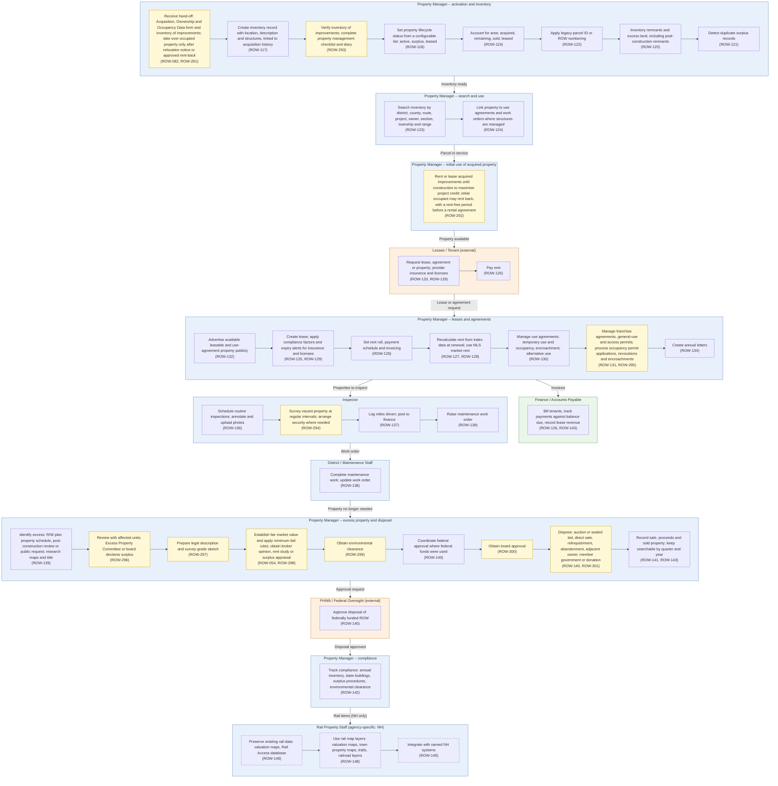

# Diagram 8 – Property Management, Leases, Inspections and Disposal

Paste the block under **Diagram** into https://mermaid.live. It renders without errors (mermaid-cli 11.12). Size: about 6316 characters.

**Legend:** blue = ROW staff and approvers, orange = external party, green = system or finance. **Yellow = a new requirement (ROW-233 onward; see New_Requirements.md).** **Dashed purple outline = agency-specific item.** Evidence codes: **V** stated in a project source, **A** shown in your agency SOPs or workflows, **O** carried from your original diagram or feature list, **D** my design decision, **U** your decision.

Source short names: NDOT (Nevada DOT ROW Manual 2025), HDOT (Hawaii DOT HWY-R Manual 2025), ATP (Austin Transit Partnership manuals), TH (Training Handbook), TBW (Tampa Bay Water guideline), REM, GP, EF, PA SOP, ED SOP, Donation, Developer, Early, Settlement and RFF SOPs (Orange County, Florida), P1, P2 and Conveyance workflows, PUA matrix (City of Virginia Beach), IRWIN manuals, lifecycle document (Researcher Copilot).

## What changed in this final set

| Change | Reason |
|---|---|
| Added activation after title vests and occupant notice, inventory verification, initial occupant rental, surveillance | NDOT 13.601-606 |
| Disposal rebuilt: excess identification, committee, legal description, valuation and minimum bids, environmental clearance, federal approval, board approval, disposal methods | NDOT 13.8; Tampa Bay Water guideline |
| Added occupancy permit handling | NDOT ch.10 |
| Demolition and securing (ROW-098) moved to Diagram 10; railroad crossing agreements (ROW-145) moved to Diagram 9 | Your decisions |
| NH-specific rail data kept with the agency tag; reports moved to Diagram 13 | Your decisions |

## Diagram

## Source verification matrix

| Node | Evidence | Source and detail |
|---|---|---|
| P1_a Hand-off, activation | V, O | ROW-082. NDOT 13.601-13.602 (starts after title vests; receives Acquisition, Ownership and Occupancy Data and Inventory of Improvements; does not take over occupied property until the Relocation Agent's Property Management Notice B). **ROW-291** |
| P1_b Inventory record | O | ROW-117 |
| P1_c Verify inventory, checklist | V | NDOT 13.602B, 13.604 (inventory verified at possession; move-in and move-out checklist). **ROW-293** |
| P1_d to P1_h Status, area, legacy ID, remnants, duplicates | O | ROW-118, 119, 122, 120, 121. No source for duplicate detection (ROW-121). Lifecycle status is a manual configurable list by your decision |
| P2_a, P2_b Search, link | O | ROW-123, ROW-124 |
| P4_a Initial use | V | NDOT 13.504 (rent or lease advance-acquired property to maximise project credits), 13.603 (initial occupant rent-free up to 60 days after close of escrow, then a rental agreement); HDOT Fair Rental (24.102(m)). **ROW-292** |
| O_a, O_b Lessee | O | ROW-133, 129, 126 |
| P3_a to P3_e, P3_g Leases and agreements | O | ROW-132, 125, 129, 126, 127, 128, 130, 134. NDOT 13.701-13.708 cover rental and use agreements. No source for annual letters or advertisement of leasable property |
| P3_f Permits | O, V | ROW-131. NDOT ch.10 (applications, processing, revocation, temporary occupancy, illegal encroachments). **ROW-295** |
| F_a Billing | O | ROW-126, ROW-143 |
| I_a Inspections | O, V | ROW-136. NDOT 13.605 |
| I_b Vacant property | V | NDOT 13.606 (regular inspection for damage, vandalism, unauthorised use; law enforcement or security where needed). **ROW-294** |
| I_c, I_d Mileage, work order | O | ROW-137, ROW-138. No source |
| DS_a Maintenance | O | ROW-138; NDOT 13.607 |
| S_a Identify excess | V, O | ROW-139. NDOT 13.801 (three ways: R/W plan property schedule, post-construction review, public request) |
| S_b Committee declares surplus | V | NDOT 13.802 (Excess Property Committee, quorum of four program areas); TBW (in-house review of other uses before the Board or General Manager declares surplus). **ROW-296** |
| S_c Legal description | V | NDOT 13.803. **ROW-297** |
| S_d Value, minimum bid | V, O | NDOT 13.804, 13.509 (fair market value; 90% minimum bid at auction, 100% for direct sale of Title 23 property). ROW-054, **ROW-298** |
| S_e Environmental clearance | V | NDOT 13.805A. **ROW-299** |
| S_f Federal approval | V, O | ROW-140. NDOT 13.805B, 13.508 (23 CFR 710.403, 710.405; approval can be delegated except on the Interstate) |
| S_g Board approval | V | NDOT 13.806; TBW. **ROW-300** |
| S_h Disposal methods | V, O | NDOT 13.807, 13.510-13.511; TBW (sealed bid, advertisement, adjacent owner, member government, other agency or charity). ROW-140, **ROW-301** |
| S_i Record sale | O | ROW-141, ROW-143 |
| FH_a, C_a Federal approval, compliance | O | ROW-140, ROW-142 |
| R_b to R_d Rail data (agency-specific) | O | ROW-146, 148, 149. Dashed outline marks NH-specific systems |

## Moved out of this diagram

| Feature | Now in |
|---|---|
| ROW-145 railroad crossing agreements | Diagram 9 |
| ROW-135, 144, 147 reports | Diagram 13 |

## Open items

1. ROW-121, 134, 137, 138, 132 have no source evidence in the files; kept.
