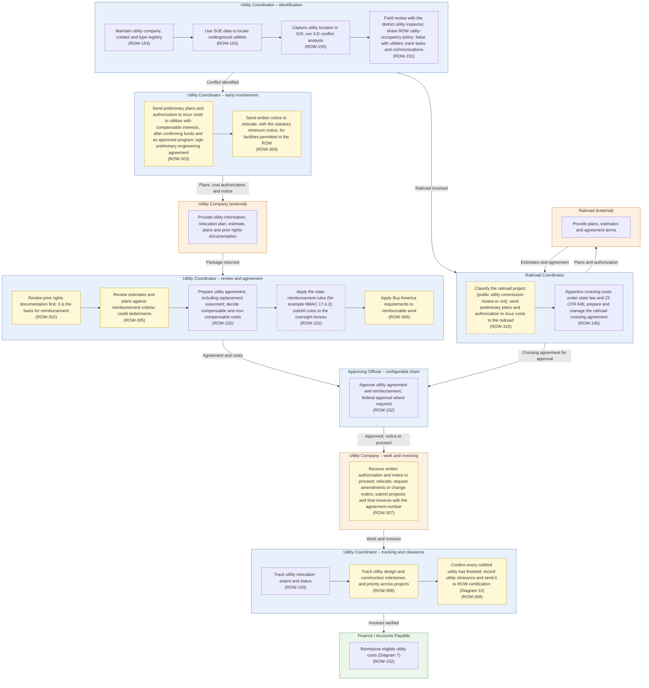

# Diagram 9 – Utility and Railroad Coordination

Paste the block under **Diagram** into https://mermaid.live. It renders without errors (mermaid-cli 11.12). Size: about 4363 characters.

**Legend:** blue = ROW staff and approvers, orange = external party, green = system or finance. **Yellow = a new requirement (ROW-233 onward; see New_Requirements.md).** **Dashed purple outline = agency-specific item.** Evidence codes: **V** stated in a project source, **A** shown in your agency SOPs or workflows, **O** carried from your original diagram or feature list, **D** my design decision, **U** your decision.

Source short names: NDOT (Nevada DOT ROW Manual 2025), HDOT (Hawaii DOT HWY-R Manual 2025), ATP (Austin Transit Partnership manuals), TH (Training Handbook), TBW (Tampa Bay Water guideline), REM, GP, EF, PA SOP, ED SOP, Donation, Developer, Early, Settlement and RFF SOPs (Orange County, Florida), P1, P2 and Conveyance workflows, PUA matrix (City of Virginia Beach), IRWIN manuals, lifecycle document (Researcher Copilot).

## What changed in this final set

| Change | Reason |
|---|---|
| Added prior rights, authorization to incur costs, preliminary engineering agreement, notice to relocate, estimate review, notice to proceed, change orders and invoicing | NDOT 9.302, 9.400-9.503 |
| Added utility clearance output feeding ROW certification | NDOT 9.501; HDOT 2.15 |
| Added utility design and construction milestones and cross-project priority | PUA coordination matrix (City of Virginia Beach) |
| Renamed to Utility and Railroad Coordination; railroad crossing agreements (ROW-145) moved in | Your decision; NDOT ch.11 |
| State-specific rules (NMAC 17.4.2, public utility commission review) kept with the agency tag; reports moved to Diagram 13 | Your decisions |

## Diagram

## Source verification matrix

| Node | Evidence | Source and detail |
|---|---|---|
| U1_a to U1_c Registry, SUE, GIS | O | ROW-154, 153, 155. NDOT 9.304 (SUE) |
| U1_d Field review, liaison | O, V | ROW-151. NDOT 9.302A (field review with the district utility inspector) |
| U2_a Authorization to incur costs | V | NDOT 9.302C, 9.400: preliminary plans and an Authorization to Incur Costs letter to companies that may have compensable interests after funds and an approved program are verified. **ROW-303** |
| U2_b Notice to relocate | V | NDOT 9.302F (minimum 30 days under NRS 408.210(4) for permitted facilities). **ROW-304** |
| UC_a Utility package | V | NDOT 9.401 (estimate, plans and prior rights documentation) |
| U3_a Prior rights | V, A | NDOT 9.401 (reviewed first; basis for reimbursement; a prior right exists if the facility was in place when the road became a state highway); PUA matrix (Prior Rights Requested, Completed, Demonstrated). **ROW-302** |
| U3_b Estimate review | V | NDOT 9.401-9.402 (reimbursable and non-reimbursable items; credits for betterments). **ROW-305** |
| U3_c Agreement | V, O | ROW-152. NDOT 9.405 (replacement easement); HDOT 2.14 (agreement forms by cost level, number assignment, log) |
| U3_d State rules (agency-specific) | O | ROW-152. NMAC 17.4.2 and the oversight bureau come from the original; NDOT cites NAC 408 for the same purpose |
| U3_e Buy America | V | NDOT 9.302G. **ROW-306** |
| AP_a Approval | O, V | ROW-152. HDOT 2.14-7 (FHWA approval of agreements) |
| UC2_a Notice to proceed, change orders, invoices | V | NDOT 9.5 (authorization to proceed, notice to proceed, amendments and change orders, progress and final invoices with the agreement number). **ROW-307** |
| U4_a Relocation tracking | O | ROW-150 |
| U4_b Milestones, priority | A | PUA matrix: priority ranking, design and construction requested, authorized and percent complete, responsible party. **ROW-308** |
| U4_c Utility clearance | V | NDOT 9.501 (confirm every notified utility has relocated); HDOT 2.15. **ROW-309** |
| F_a Reimbursement | O | ROW-152 |
| RR_a Railroad type and plans | V | NDOT 11.301-303 (Type A subject to public utility commission review, Type B not; preliminary plans and authorization to incur costs to the railroad; federal-aid program check). The commission review is state-specific (dashed). **ROW-310** |
| RR_b Crossing agreement | V, O | ROW-145. NDOT 11.302 (crossing costs apportioned under state law and 23 CFR 646.208-646.212) |

## Moved out of this diagram

| Feature | Now in |
|---|---|
| ROW-156 utility reports | Diagram 13 |

## Open items

1. NDOT 8.402 (discretionary utility relocation payments) is not drawn; it is a relocation payment type for extraordinary utility costs. Say if you want it.
