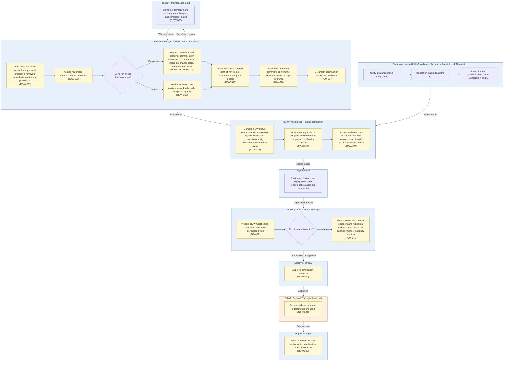

# Diagram 10 – ROW Clearance and Certification

Paste the block under **Diagram** into https://mermaid.live. It renders without errors (mermaid-cli 11.12). Size: about 3744 characters.

**Legend:** blue = ROW staff and approvers, orange = external party, green = system or finance. **Yellow = a new requirement (ROW-233 onward; see New_Requirements.md).** **Dashed purple outline = agency-specific item.** Evidence codes: **V** stated in a project source, **A** shown in your agency SOPs or workflows, **O** carried from your original diagram or feature list, **D** my design decision, **U** your decision.

Source short names: NDOT (Nevada DOT ROW Manual 2025), HDOT (Hawaii DOT HWY-R Manual 2025), ATP (Austin Transit Partnership manuals), TH (Training Handbook), TBW (Tampa Bay Water guideline), REM, GP, EF, PA SOP, ED SOP, Donation, Developer, Early, Settlement and RFF SOPs (Orange County, Florida), P1, P2 and Conveyance workflows, PUA matrix (City of Virginia Beach), IRWIN manuals, lifecycle document (Researcher Copilot).

## What changed in this final set

| Change | Reason |
|---|---|
| New diagram for lifecycle Stage 9 (Clearance and Certification) | Your decision; lifecycle document; Practitioner Handbook Phase 6; TH 4.5 |
| Physical clearance: vacancy verification, hazardous materials, demolition or sale of improvements, permits, contract, environmental commitments, site documentation | Practitioner Handbook Phase 6; NDOT 13.506, 13.608-13.610 |
| Certification: status matrix, checklist, encroachments and hazardous waste, certification document with configurable type, conditions, internal and federal approval, release to construction | Lifecycle Stage 9; NDOT 7.435; HDOT |
| ROW-098 moved in from Diagram 5 | Your decision |

## Diagram

## Source verification matrix

| Node | Evidence | Source and detail |
|---|---|---|
| CL_a Vacancy and site condition | V | Practitioner Handbook Phase 6 (confirm occupants vacated and personal property removed; document site condition at possession). **ROW-311** |
| CL_b Hazardous materials | V | NDOT 13.610A; Practitioner Handbook Phase 6. **ROW-312** |
| CL_c to CL_e Demolish or sell | V | NDOT 13.506, 13.608-13.609 (improvements demolished, or sold by auction, sealed bid or to a public agency). **ROW-313**; demolition request ROW-098 with **ROW-314** (Practitioner: permits, utility disconnection, lead and asbestos abatement; NDOT 13.602) |
| CL_f Clearance contract | V | NDOT 13.609-13.610 (service agreements; right-of-way item or construction item; monitoring). **ROW-315** |
| CL_g Environmental commitments | V | Practitioner Handbook Phase 6. **ROW-316** |
| CL_h Site documentation | V | Practitioner Handbook Phase 6. **ROW-317** |
| DS_a Demolition and securing | O | ROW-098 (moved from Diagram 5) |
| SP_a to SP_c Status providers | V | Lifecycle Stage 9 inputs (acquisition status list, relocation status, utility clearance, condemnation status) |
| ST_a Status matrix | V | Lifecycle Stage 9. **ROW-318** |
| ST_b Certification checklist | V | NDOT 7.435 (acquisition recorded in the Project Certification Checklist). **ROW-319** |
| ST_c Encroachments, hazardous waste | V | HDOT (FHWA key elements: lawful acquisition, relocation of people, encroachments and structures with who removes them, hazardous waste identification). **ROW-320** |
| LC_a Legal confirmation | V | Lifecycle Stage 9 (Legal Counsel confirms acquisitions are legally sound) |
| CO_a to CO_c Certification, conditions | V, U | NDOT 2.411, 7.426 (certification on all projects, may be conditional); lifecycle Stage 9. **Certification types are configurable and not defined, by your decision.** HDOT text (FHWA guidance) defines three types and the Training Handbook defines them differently; neither is used. **ROW-321** |
| AP_a, FH_a Approval, federal concurrence | V | Lifecycle Stage 9; HDOT (certification to FHWA before authorization to advertise). **ROW-322** |
| PJ_a Release to construction | V | HDOT (23 CFR 635.309: authorization to advertise); lifecycle Stage 9. **ROW-323** |

## Open items

1. Certification types are left configurable and undefined by your decision. The Training Handbook (Type 3 = early utility relocations) disagrees with the FHWA text quoted in the Hawaii manual (Type 3 = acquisition incomplete with occupants still present); the handbook may need correcting.
