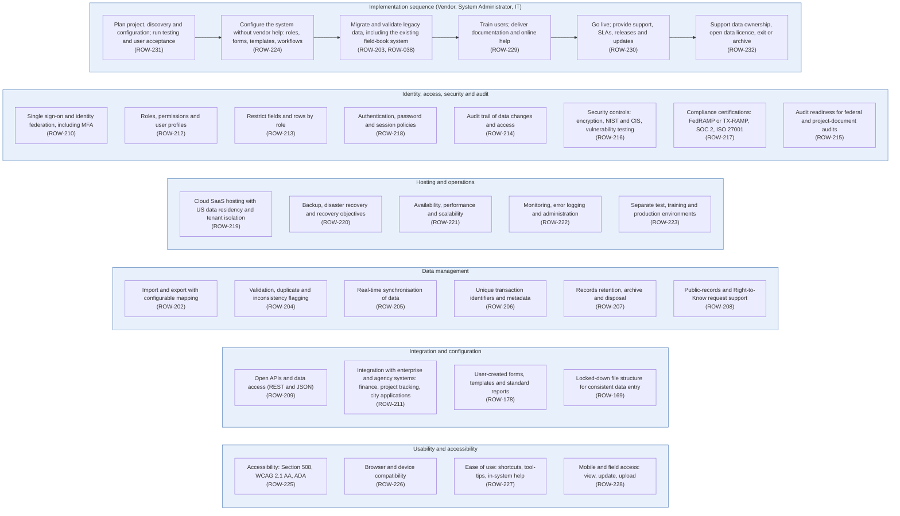

# Diagram 11 – Platform Set-up, Security, Hosting and Implementation

Paste the block under **Diagram** into https://mermaid.live. It renders without errors (mermaid-cli 11.12). Size: about 3410 characters.

**Legend:** blue = ROW staff and approvers, orange = external party, green = system or finance. **Yellow = a new requirement (ROW-233 onward; see New_Requirements.md).** **Dashed purple outline = agency-specific item.** Evidence codes: **V** stated in a project source, **A** shown in your agency SOPs or workflows, **O** carried from your original diagram or feature list, **D** my design decision, **U** your decision.

Source short names: NDOT (Nevada DOT ROW Manual 2025), HDOT (Hawaii DOT HWY-R Manual 2025), ATP (Austin Transit Partnership manuals), TH (Training Handbook), TBW (Tampa Bay Water guideline), REM, GP, EF, PA SOP, ED SOP, Donation, Developer, Early, Settlement and RFF SOPs (Orange County, Florida), P1, P2 and Conveyance workflows, PUA matrix (City of Virginia Beach), IRWIN manuals, lifecycle document (Researcher Copilot).

## What changed in this final set

| Change | Reason |
|---|---|
| Redrawn as an implementation flow plus capability groups with no sequence arrows | Your decision |
| ROW-038 (field-book migration) moved in from Diagram 2 | Your decision |
| Each feature appears once, in the flow or in a capability group | Audit script |

## Diagram

## Source verification matrix

| Node | Evidence | Source and detail |
|---|---|---|
| IM_a to IM_f Implementation sequence | O | ROW-231, 224, 203, 229, 230, 232 and ROW-038 from Diagram 2. The sequence plan, configure, migrate, train, go live, exit is the original's; it is the only real flow among the platform diagrams |
| G1 Identity, access, security and audit | O | ROW-210, 212, 213, 218, 214, 216, 217, 215 |
| G2 Hosting and operations | O | ROW-219 to ROW-223 |
| G3 Data management | O | ROW-202, 204 to 208 |
| G4 Integration and configuration | O | ROW-209, 211, 178, 169 |
| G5 Usability and accessibility | O | ROW-225 to ROW-228 |

## Open items

1. Platform requirements are capabilities, not agency process; no agency SOP in the files describes them.
