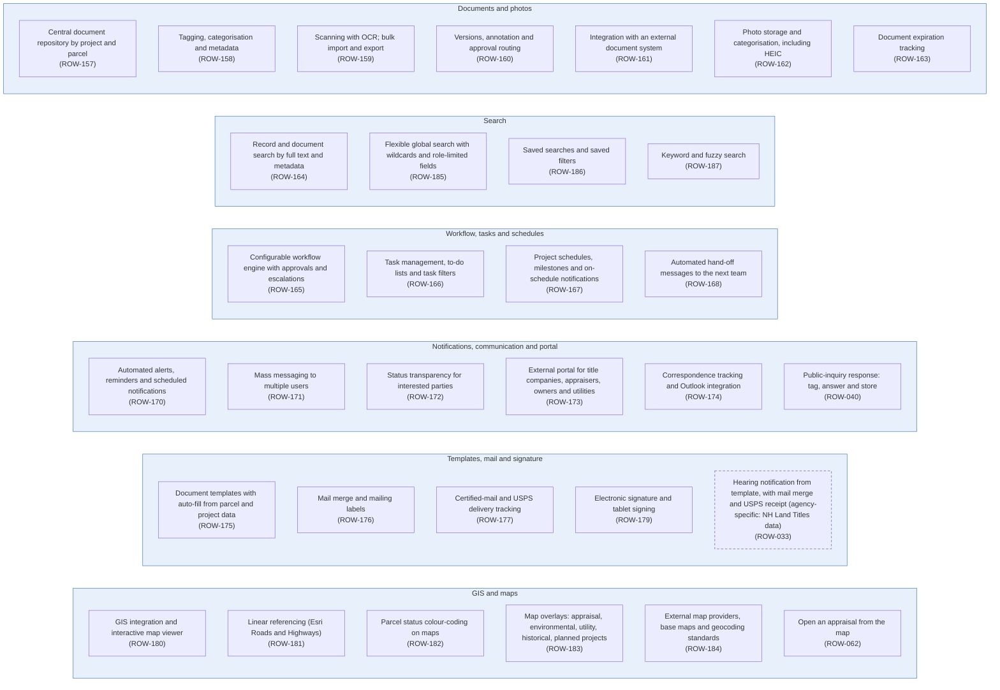

# Diagram 12 – Everyday Platform Services: Documents, Workflow, Communications, Templates, GIS and Search

Paste the block under **Diagram** into https://mermaid.live. It renders without errors (mermaid-cli 11.12). Size: about 3120 characters.

**Legend:** blue = ROW staff and approvers, orange = external party, green = system or finance. **Yellow = a new requirement (ROW-233 onward; see New_Requirements.md).** **Dashed purple outline = agency-specific item.** Evidence codes: **V** stated in a project source, **A** shown in your agency SOPs or workflows, **O** carried from your original diagram or feature list, **D** my design decision, **U** your decision.

Source short names: NDOT (Nevada DOT ROW Manual 2025), HDOT (Hawaii DOT HWY-R Manual 2025), ATP (Austin Transit Partnership manuals), TH (Training Handbook), TBW (Tampa Bay Water guideline), REM, GP, EF, PA SOP, ED SOP, Donation, Developer, Early, Settlement and RFF SOPs (Orange County, Florida), P1, P2 and Conveyance workflows, PUA matrix (City of Virginia Beach), IRWIN manuals, lifecycle document (Researcher Copilot).

## What changed in this final set

| Change | Reason |
|---|---|
| Redrawn as capability groups with no sequence arrows | Your decision |
| ROW-033 (hearing notification), ROW-040 (public inquiry) and ROW-062 (open an appraisal from the map) moved in | Diagrams 2 and 3 |
| Used-by links recorded in the matrix | Cross-diagram reconciliation |

## Diagram

## Source verification matrix

| Node | Evidence | Source and detail |
|---|---|---|
| G1 Documents and photos | O | ROW-157 to ROW-163. The Orange County SOPs keep the permanent file in a shared drive; document versioning is also referenced by Diagram 3 (ROW-047) |
| G2 Search | O | ROW-164, 185 to 187 |
| G3 Workflow, tasks and schedules | O | ROW-165 to ROW-168. The configurable approval chains in Diagrams 3, 4, 6, 7 and 9 run on this engine |
| G4 Notifications, communication and portal | O | ROW-170 to ROW-174; ROW-040 from Diagram 2. ROW-173 is the external portal used by title companies (Diagram 2) and appraisers (Diagram 3) |
| G5 Templates, mail and signature | O, V | ROW-175 to ROW-177, 179; ROW-033 from Diagram 2 (agency-specific, dashed). ROW-179 safeguards in NDOT 7.403 (timestamp, signature linked to the document, certification); the York RFP is the only source for tablet signing. Used by Diagram 4 |
| G6 GIS and maps | O | ROW-180 to ROW-184; ROW-062 from Diagram 3 (ROW-183 already offers an appraisal overlay) |

