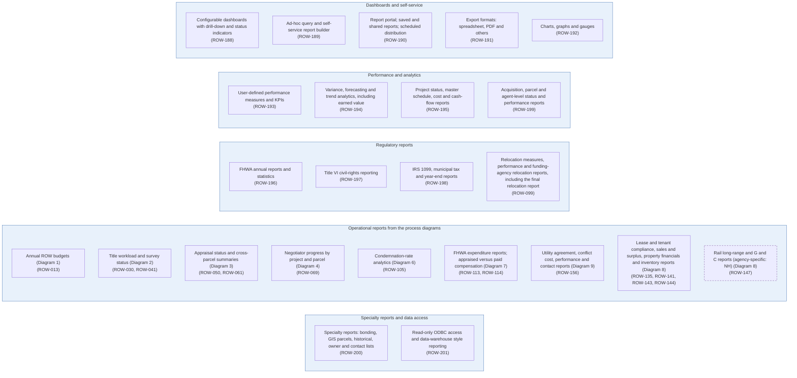

# Diagram 13 – Reporting, Dashboards and Analytics

Paste the block under **Diagram** into https://mermaid.live. It renders without errors (mermaid-cli 11.12). Size: about 2736 characters.

**Legend:** blue = ROW staff and approvers, orange = external party, green = system or finance. **Yellow = a new requirement (ROW-233 onward; see New_Requirements.md).** **Dashed purple outline = agency-specific item.** Evidence codes: **V** stated in a project source, **A** shown in your agency SOPs or workflows, **O** carried from your original diagram or feature list, **D** my design decision, **U** your decision.

Source short names: NDOT (Nevada DOT ROW Manual 2025), HDOT (Hawaii DOT HWY-R Manual 2025), ATP (Austin Transit Partnership manuals), TH (Training Handbook), TBW (Tampa Bay Water guideline), REM, GP, EF, PA SOP, ED SOP, Donation, Developer, Early, Settlement and RFF SOPs (Orange County, Florida), P1, P2 and Conveyance workflows, PUA matrix (City of Virginia Beach), IRWIN manuals, lifecycle document (Researcher Copilot).

## What changed in this final set

| Change | Reason |
|---|---|
| Redrawn as capability groups with no sequence arrows | Your decision |
| Operational reports from Diagrams 1 to 9 collected in one group | Cross-diagram reconciliation |

## Diagram

## Source verification matrix

| Node | Evidence | Source and detail |
|---|---|---|
| G1 Dashboards and self-service | O | ROW-188 to ROW-192 |
| G2 Performance and analytics | O | ROW-193, 194, 195, 199 |
| G3 Regulatory reports | O, V | ROW-196 to ROW-198; ROW-099 (ATP 11: monthly or quarterly reports to the funding agency and a final relocation report; records kept three years after final payment). HDOT 2.8: 1099-S reporting when a purchase exceeds the reporting threshold |
| G4 Operational reports | O | ROW-013 (annual budgets; NDOT 2.312), 030, 041, 050, 061, 069, 105, 113, 114, 156, 135, 141, 143, 144, 147. Source diagrams are named on each box |
| G5 Specialty and data access | O | ROW-200, ROW-201 |

